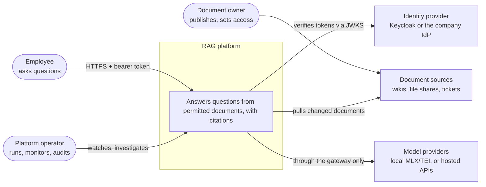
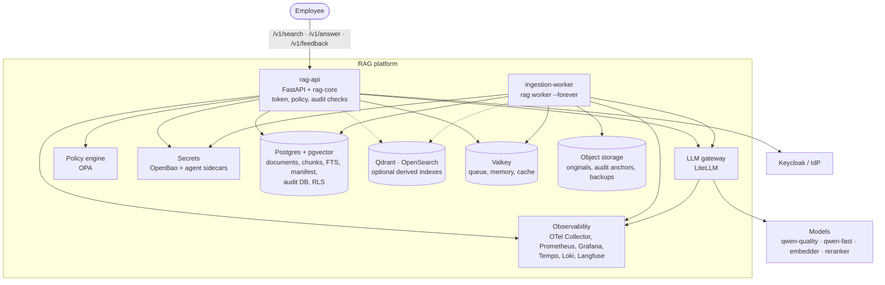
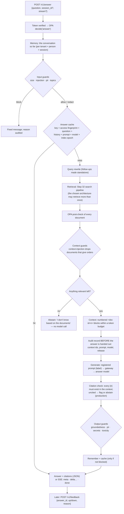
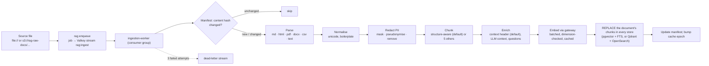
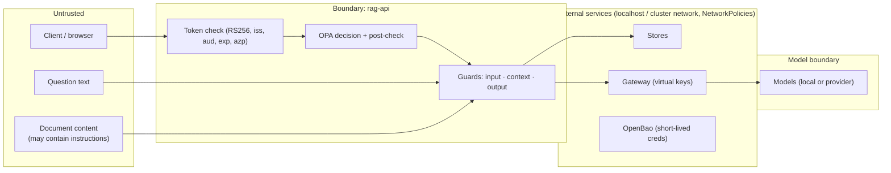

# Architecture and system design

> **IN PLAIN ENGLISH**
> The platform answers employees' questions from the company's own documents, with citations, and
> only from documents each person is allowed to see. Documents are read, cleaned of personal data,
> cut into passages, turned into numbers that capture meaning, and stored. When someone asks, the
> platform checks who they are and what they may see, finds the best passages by both meaning and
> exact words, re-ranks them, gives the top few to a language model with strict instructions, checks
> the answer's citations and safety, records *that* it happened (never *what* was said) in a
> tamper-evident log, and returns it. Everything around that (sign-in, permissions, secrets, models,
> monitoring) is a separate, replaceable service with one job.

This page is the map. Each part links to the step that built it and the decision record (ADR) that
explains the choice. The C4 model as code is [`workspace.dsl`](workspace.dsl); the managed-service
equivalents are in [cloud-mapping.md](cloud-mapping.md); the RAG techniques themselves are in the
[RAG handbook](../concepts/rag-handbook.md).

Contents: [1 · Context](#1-system-context) · [2 · Containers](#2-containers) ·
[3 · Where things run](#3-where-things-run) · [4 · A search](#4-request-flow-v1search) ·
[5 · An answer](#5-request-flow-v1answer) · [6 · Ingestion](#6-ingestion-flow) ·
[7 · Data stores](#7-data-stores-and-why-each-exists) · [8 · Trust boundaries](#8-trust-boundaries) ·
[9 · Scaling and HA](#9-scaling-and-high-availability) · [10 · Failure modes](#10-failure-modes-and-degradation) ·
[11 · Code structure](#11-code-structure) · [12 · Decisions](#12-decision-summary-every-adr)

---

## 1. System context

Who uses the platform and what it depends on (C4 level 1).



## 2. Containers

The deployable parts (C4 level 2), as in [`workspace.dsl`](workspace.dsl).



| Container | Job | Built in | ADR |
|---|---|---|---|
| rag-api | The only door for people and machines: verifies tokens, asks OPA, runs search and answers through rag-core, writes the audit log | Steps 17, 18, 23, 32, 33 | [0017](../adr/0017-validate-jwts-locally-in-every-service.md) |
| ingestion-worker | Takes jobs from the Valkey stream; parse → clean → redact → chunk → enrich → embed → index | Step 31 | [0031](../adr/0031-ingest-through-a-replace-not-append-pipeline.md) |
| LiteLLM gateway | One OpenAI-compatible API for all models: role names, keys, budgets, rate limits, fallbacks, cost | Steps 9, 10 | [0009](../adr/0009-route-all-model-access-through-a-litellm-gateway.md), [0010](../adr/0010-govern-model-access-with-virtual-keys-budgets-shadow-prices-and-fallbacks.md) |
| OPA | Decides actions and which documents a person may see; the filter goes into every query | Step 18 | [0018](../adr/0018-use-opa-as-the-policy-decision-point.md) |
| OpenBao (+ agent) | Short-lived database users and app keys, written as files the apps re-read | Step 28 | [0028](../adr/0028-issue-database-credentials-dynamically-from-openbao.md) |
| Keycloak | Sign-in, groups, service accounts; issues short-lived signed tokens | Step 16 | [0016](../adr/0016-use-keycloak-for-identity.md) |
| Postgres + pgvector | System of record: documents, chunks, vectors, full text, manifest; separate `audit` database | Steps 11, 23, 31, 36 | [0011](../adr/0011-use-postgres-with-pgvector-as-the-primary-document-and-vector-store.md) |
| Qdrant, OpenSearch | Optional dedicated vector and keyword engines (`local-engines` profile), always rebuildable | Steps 12, 13 | [0012](../adr/0012-use-qdrant-as-a-derived-vector-index-alongside-postgres.md), [0013](../adr/0013-use-opensearch-for-keyword-and-hybrid-search-as-a-derived-index.md) |
| Valkey | Ingestion queue (Streams), conversation memory, answer cache, gateway cache, locks | Steps 15, 31, 33 | [0015](../adr/0015-use-valkey-for-cache-queues-and-locks.md) |
| SeaweedFS (S3) | Original documents (versioned), write-once audit archive, Langfuse events, temp files | Steps 14, 22, 23 | [0014](../adr/0014-use-seaweedfs-as-the-s3-compatible-object-store-instead-of-minio.md) |
| Observability stack | Traces, metrics, logs, LLM traces, SLO alerts; no question or answer text outside Langfuse | Steps 19–22 | [0019](../adr/0019-use-opentelemetry-and-a-central-collector.md)–[0022](../adr/0022-use-self-hosted-langfuse-for-llm-traces.md) |

## 3. Where things run

| Layer | Local (your Mac) | Staging / prod |
|---|---|---|
| Models | **Native macOS**: mlx-lm on 8081/8082, TEI on 8083/8084, launchd; they need the Metal GPU ([ADR-0004](../adr/0004-orbstack-native-models-containerised-services.md)) | GPU nodes (vLLM/TGI) or hosted models behind the same gateway |
| Stateful services | Docker Compose in OrbStack's Linux VM (24 GB cap), 127.0.0.1 ports only | Operators (CloudNativePG) or managed services ([cloud mapping](cloud-mapping.md)) |
| rag-api | Compose (`just up`) or OrbStack Kubernetes via Argo CD (`deploy/envs/local`) | Kubernetes, Argo Rollouts canary, 3 zones (`deploy/envs/prod`) |
| Worker and jobs | Compose `ingestion-worker` | Deployment + CronJobs under their own identity (`deploy/base/rag-ingest`) |

Containers reach the native models through `host.docker.internal`; pods reach Compose services through
`ExternalName` aliases ([`deploy/components/external-deps`](../../deploy/components/external-deps/)), and
in production through [`managed-deps`](../../deploy/components/managed-deps/). rag-api's settings never
change between environments: only where each *name* points.

---

## 4. Request flow: `/v1/search`

```mermaid
sequenceDiagram
  autonumber
  participant U as Person / client
  participant A as rag-api
  participant K as Keycloak JWKS
  participant O as OPA
  participant S as rag-core SearchPipeline
  participant G as LiteLLM (embedder, reranker)
  participant D as Stores (pgvector + FTS / Qdrant + OpenSearch)
  participant L as Audit DB
  U->>A: POST /v1/search {query, k} + Bearer token
  A->>K: (cached) signing keys; verify RS256, issuer, audience, expiry, client
  A->>O: decide(principal, "search") → allow + filter (groups, classifications)
  A->>S: search(query, filter)
  S->>S: query transform (identity by default)
  par dense and keyword in parallel
    S->>G: embed query (registered query instruction)
    S->>D: vector search INSIDE the access filter
  and
    S->>D: keyword search INSIDE the access filter
  end
  S->>S: fuse (RRF k=60) → re-check access → rerank top 30 via G (fails open) → dedupe, min-score, max 3/doc
  S-->>A: ranked chunks with per-stage scores
  A->>O: readable(principal, candidate documents)  [post-check]
  A->>L: append event: who, which document ids, counts, prompt version (never the text)
  A-->>U: hits
```

**Why two permission checks.** The *pre-filter* (OPA's filter pushed into every store's query) keeps
search fast and correct; the *post-check* re-asks OPA about every returned document, so a bug in a
store's query can never become a leak. A disagreement drops the document and fires
`RagPolicyQueryMismatch` ([runbook](../runbooks/rag-policy-mismatch.md)). The rag-core pipeline adds its
own access re-check after fusion as a third line. Code: `services/rag-api/src/rag_api/main.py`,
`libs/rag-core/src/rag_core/search.py`; decision: [ADR-0032](../adr/0032-search-through-a-switchable-hybrid-pipeline.md).

## 5. Request flow: `/v1/answer`

The answer pipeline (`libs/rag-core/src/rag_core/answer.py`) wraps search with memory, guards, cache,
generation and checks. The order matters, and is the same for every architecture:



- **Streaming** (`stream: live | checked`): `live` sends words as they're generated, before output
  guards run; `checked` (the `production` profile) sends nothing unchecked. A model failure mid-stream
  sends an `error` event, never a half answer marked `done`.
- **Abstention and citations** are deliberate product behaviour: see
  [ADR-0033](../adr/0033-answer-with-checked-citations-and-abstention.md) and the
  [handbook](../concepts/rag-handbook.md#12-citations-and-abstention).
- **What's recorded.** The audit log stores ids, counts, outcomes, guard verdicts, prompt and model
  versions and the release; Langfuse stores the masked text for debugging under its own retention;
  Tempo stores timings (no text). See [quality-and-operations.md](../guides/quality-and-operations.md#4-audit-and-governance).

## 6. Ingestion flow



Replace-not-append means re-ingesting a changed document never leaves stale chunks behind; redaction
happens **before** anything is stored, so personal data never reaches an index, cache or trace
([ADR-0031](../adr/0031-ingest-through-a-replace-not-append-pipeline.md)). Lifecycle operations
(retention, erasure, access changes, blue/green re-index) go through the same stores
([ADR-0036](../adr/0036-lifecycle-tenant-isolation-and-a-risk-register-as-code.md)).

---

## 7. Data stores and why each exists

| Store | Holds | Source of truth? | Why this one | If lost |
|---|---|---|---|---|
| Postgres `rag` (pgvector) | Collections, documents (ACL groups, classification, tenant), chunks (halfvec(1024) + HNSW, tsvector + GIN), ingest manifest | **Yes** | One transactional place for text, vectors, keyword search and permissions; row-level security per tenant | Restore (PITR in prod) |
| Postgres `audit` | Hash-chained `audit.events`; roles migrator / writer (append only) / reader | **Yes** (plus anchors) | Same proven database, separated by roles; append-only trigger and chain | Restore; anchors prove integrity |
| Qdrant | Vectors + payload filters (alias `rag_chunks`) | No (derived) | Dedicated vector engine for scale / quantisation | `rag reindex` |
| OpenSearch | BM25 with analysers and synonyms, k-NN (alias `rag-chunks`) | No (derived) | Strong keyword search, hybrid pipeline | `rag reindex` |
| SeaweedFS (S3) | `rag-raw-docs` (versioned originals), `rag-audit-archive` (object lock), `rag-tmp`, `langfuse` | Yes for originals | S3 API everywhere, Apache-2.0, MinIO no longer maintained | Versioning + backups |
| Valkey | `rag:ingest` stream, conversation memory, answer cache, gateway cache | No (disposable) | Fast, TTLs, Streams consumer groups, BSD licence | Conversations and cached answers only |
| litellm-db | Gateway keys, teams, spend | Yes (gateway state) | Isolated from the RAG data | Re-issue keys |
| keycloak-db | Realm state, users | Yes (identity) | Keycloak's own store; realm as code in git | Re-import realm, re-create users |
| Prometheus / Tempo / Loki | Metrics 15 d / traces 7 d / logs 7 d | No | Standard open stack | History only |
| Langfuse (Postgres, ClickHouse, Valkey, S3) | LLM traces with masked content, 30-day retention | No | Content needs its own access and retention | Debug history only |
| OpenBao (raft) | Policies, roles, KV secrets, leases, audit file | Yes (secrets) | Dynamic DB users, open-source Vault fork | Re-init + re-put (bootstrap values are in SOPS) |

Design rule from [ADR-0012](../adr/0012-use-qdrant-as-a-derived-vector-index-alongside-postgres.md):
there is **one source of truth**; every search engine is a derived index that can be rebuilt from Postgres
and the originals.

## 8. Trust boundaries



| Boundary | What crosses | Controls |
|---|---|---|
| Client → rag-api | Tokens, questions | Short-lived RS256 tokens verified locally; 401 vs 403; size guard; rate limits at the gateway |
| rag-api → stores | Queries | OPA filter inside every query; RLS by tenant; dynamic least-privilege DB users; post-check |
| Documents → model | Retrieved text | PII redacted at ingestion; context-injection guard; numbered sources; output guards |
| Apps → models | Prompts | Only via LiteLLM with per-app virtual keys, allow-lists, budgets; no content in gateway traces |
| Apps → secrets | Credentials | OpenBao agent files (0400), wrapped single-use secret IDs, per-workload identity |
| Platform → telemetry | Spans, logs, metrics | Collector scrubs headers, parameters and message content; masks tokens, keys, emails |
| Operators → data | Admin access | Superuser only via `docker compose exec` / break glass; OpenBao root revoked after setup; audit chain anchored in write-once storage |
| CI → clusters | Images | Pinned actions, scanned, keyless-signed, attested; admission policy allows only digest-pinned images from your registry |

The full STRIDE list (19 threats, 30 controls, each with test evidence) is generated from the risk
register: [threat model](../security/threat-model.md), [controls](../compliance/controls.md).

## 9. Scaling and high availability

- **rag-api is stateless**: memory and cache live in Valkey, so replicas are interchangeable. The
  production HPA scales on CPU (70%), min 3 (one per zone), max 12; pods spread across zones (hard)
  and hosts (soft); the PDB allows one pod down at a time.
- **The worker** scales on queue length, not CPU (KEDA is the named option); Valkey consumer groups
  share jobs, and unacknowledged jobs are reclaimed after 5 minutes.
- **Postgres** in prod: CloudNativePG, 3 instances across zones, quorum synchronous replication
  (`any 1`), WAL archiving and nightly base backups to another region, 30-day PITR.
- **Models** scale behind the gateway: more backends per role name, fallbacks `qwen-fast → qwen-quality`;
  the embedder has *no* fallback on purpose (a different embedder would silently corrupt search).
- **Search engines** are derived: add Qdrant/OpenSearch (`local-engines`) when Postgres's vector or
  keyword search becomes the bottleneck; measure first with `rag eval-search`.
- **Tenants**: row-level security now; separate databases or clusters for regulated tenants later
  ([ADR-0036](../adr/0036-lifecycle-tenant-isolation-and-a-risk-register-as-code.md)).

## 10. Failure modes and degradation

The platform's rule is **fail closed on security, degrade on quality** (control C-RESILIENCE).

| Failure | Behaviour | Why | Runbook |
|---|---|---|---|
| Token invalid / forged | 401 with `WWW-Authenticate` | Never guess identity | [keycloak-login-failures](../runbooks/keycloak-login-failures.md) |
| Keycloak keys unreachable | 503 (unknown key id can't be verified) | Fail closed | same |
| OPA unreachable | 503 "Policy engine unavailable" | No decision, no data | [rag-policy-mismatch](../runbooks/rag-policy-mismatch.md) |
| Audit DB unwritable | 503: nothing is handed out unrecorded (streams: completion recorded best effort) | Accountability | [audit-log](../runbooks/audit-log.md) |
| Reranker down | **Fails open**: fused order used, counted and logged | Quality degrades, search stays up | [rag-search-errors](../runbooks/rag-search-errors.md) |
| `qwen-fast` down | Gateway falls back to `qwen-quality` | Availability | [Step 10](../steps/step-10-budgets-rate-limits-fallbacks.md) |
| Embedder down | Search errors (no fallback) | Correctness over availability ([ADR-0010](../adr/0010-govern-model-access-with-virtual-keys-budgets-shadow-prices-and-fallbacks.md)) | rag-search-errors |
| `llm-judge` / `webhook` guard down | Fail open by default (`fail_closed: false`), configurable | The pattern guards still run | [Step 34](../steps/step-34-guardrails.md) |
| Nothing relevant found | Abstain without calling a model | Honesty, cost | [answer-quality](../runbooks/answer-quality.md) |
| Model fails mid-stream | SSE `error` event, never a half answer as `done` | Integrity | — |
| OpenBao sealed / down | Existing credentials keep working until their lease ends (≤ 1 h); nothing new issued | Time to unseal | [openbao](../runbooks/openbao.md) |
| Agent restarted | Can't log in again (single-use secret ID) until `just vault-agent-start` | No standing secrets on disk | openbao |
| Valkey lost | Conversations and cached answers lost; queue re-enqueued | Disposable by design | [disaster-recovery](../runbooks/disaster-recovery.md) |
| OTel Collector down | Containers keep running (async log driver); telemetry gap alerts | Never block the product for telemetry | [otel-collector-losing-data](../runbooks/otel-collector-losing-data.md) |
| Canary worse than stable | Rollout aborted automatically; stable keeps serving | Small blast radius | [canary](../runbooks/canary.md) |
| No replica confirms a write (prod) | Writes wait (`dataDurability: required`): ingestion pauses, search continues | No lost commits | disaster-recovery |
| Search SLO burning | Burn-rate alerts at 14.4× / 6× | Page on user impact | [rag-search-errors](../runbooks/rag-search-errors.md), [rag-search-latency](../runbooks/rag-search-latency.md) |

## 11. Code structure

| Path | What |
|---|---|
| [`libs/rag-common/`](../../libs/rag-common/) | Shared plumbing: settings with `SecretStr`, token verifier, telemetry, prompt registry, cards, credentials files |
| [`libs/rag-core/`](../../libs/rag-core/) | The RAG engine: contracts, registry, profile loader, 94 components, ingestion/search/answer pipelines, architectures, lifecycle, readiness, online evaluation, SDK, doctor, `rag` CLI |
| [`libs/rag-evals/`](../../libs/rag-evals/) | Offline evaluation harness (datasets, metrics, judge, gates) |
| [`services/rag-api/`](../../services/rag-api/) | The HTTP service: auth, OPA client, audit, Langfuse, endpoints |
| [`policies/`](../../policies/) | Rego policies and tests |
| [`prompts/`](../../prompts/) | Versioned prompts, lock file, labels |
| [`cards/`](../../cards/) | Model, dataset and system cards |
| [`infra/`](../../infra/) | Compose, service configs, migrations, model serving |
| [`deploy/`](../../deploy/) | Kubernetes: cluster policies, bases, components, overlays, Argo CD, operators, data tier |
| [`rag.yaml`](../../rag.yaml) | Which component fills each slot, per profile |

rag-core's design ([ADR-0030](../adr/0030-build-rag-on-a-shared-core-of-switchable-components.md)):
one Protocol per component kind; a registry of named implementations with validated settings; a
container that builds a profile lazily; `extends`, `none` and `RAG__SLOT__SETTING` overrides. Every
store passes the same conformance kit, including access-leak tests.

---

## 12. Decision summary: every ADR

Each row: what was decided, the main alternatives the ADR weighed, and why. Full text in [docs/adr](../adr/README.md).

| ADR | Decision | Alternatives considered | Why |
|---|---|---|---|
| [0001](../adr/0001-record-architecture-decisions.md) | Record decisions as numbered, immutable Markdown ADRs | Wiki pages, long RFCs, no records | Decisions live with the code and its history |
| [0002](../adr/0002-workstation-tools-via-homebrew-brewfile.md) | Homebrew + a commented Brewfile | Nix, Dev Containers, manual installs | Reproducible, simplest for a Mac; models need Metal |
| [0003](../adr/0003-python-312-managed-by-uv.md) | Python 3.12 with uv, one workspace, one lockfile | Poetry, pip-tools, conda/pixi | Fast, standards-based, one receipt for everything |
| [0004](../adr/0004-orbstack-native-models-containerised-services.md) | Models native, services in OrbStack containers, 24 GB VM cap, localhost ports | Docker Desktop, Colima, Podman, models in containers | MLX needs the GPU; containers for everything else |
| [0005](../adr/0005-automated-code-quality-gates-with-ruff-mypy-pytest-and-pre-commit.md) | ruff, strict mypy, pytest via pre-commit | Black+isort+Flake8, pyright, prek/lefthook | One fast tool set, enforced before commit |
| [0006](../adr/0006-manage-dev-secrets-with-sops-and-age-personal-tokens-in-keychain.md) | SOPS + age file, secrets as files, tokens in Keychain | Plaintext .env, git-crypt, 1Password CLI, Vault now | Reviewable encrypted diffs; nothing in clear |
| [0007](../adr/0007-serve-local-models-natively-with-mlx-lm-behind-localhost.md) | Two Qwen models via mlx-lm on localhost, pinned revisions | Ollama, LM Studio, llama.cpp, vllm-mlx, one model | Native speed; two roles (quality, fast) |
| [0008](../adr/0008-serve-embeddings-and-reranking-with-tei-natively-behind-an-api-key.md) | TEI for embeddings and reranking, API key, embedding contract | llama.cpp server, Ollama, custom FastAPI, Infinity, bigger embedders | Fast, supports reranking, well maintained |
| [0009](../adr/0009-route-all-model-access-through-a-litellm-gateway.md) | All model access through LiteLLM with role names | Direct calls, Portkey/Kong/Envoy AI GW, custom proxy, cloud gateways | Governance in one place; swap models without code changes |
| [0010](../adr/0010-govern-model-access-with-virtual-keys-budgets-shadow-prices-and-fallbacks.md) | Virtual keys per app, team budgets, shadow prices, fallbacks (not for the embedder) | Master key everywhere, shared DB, zero prices | Cost and blast radius visible and limited |
| [0011](../adr/0011-use-postgres-with-pgvector-as-the-primary-document-and-vector-store.md) | Postgres + pgvector as system of record, least-privilege roles, dbmate | Dedicated vector DB only, OpenSearch only, sqlite-vec, Alembic | Text, vectors, ACLs and transactions together |
| [0012](../adr/0012-use-qdrant-as-a-derived-vector-index-alongside-postgres.md) | Qdrant as a derived, rebuildable vector index | pgvector only, Milvus, Weaviate, Qdrant as truth | Scale option without a second source of truth |
| [0013](../adr/0013-use-opensearch-for-keyword-and-hybrid-search-as-a-derived-index.md) | OpenSearch for BM25/hybrid as a derived index | Postgres FTS only, Elasticsearch, Qdrant sparse, Vespa | Strong keyword search, Apache-2.0, maps to AWS |
| [0014](../adr/0014-use-seaweedfs-as-the-s3-compatible-object-store-instead-of-minio.md) | SeaweedFS as S3 store; versioning, object lock, lifecycle | MinIO, Chainguard MinIO, RustFS, Garage, Ceph | Maintained, Apache-2.0, has the needed features |
| [0015](../adr/0015-use-valkey-for-cache-queues-and-locks.md) | Valkey with ACLs for cache, Streams queue, locks | Redis 8, separate instances, RabbitMQ/Kafka, Postgres queue | BSD licence; Streams suffice |
| [0016](../adr/0016-use-keycloak-for-identity.md) | Keycloak realm as code; groups mirror document ACLs | Authentik/Zitadel, Ory, Entra/Okta/Auth0, own logins | Standard OIDC, self-hostable, brokers to company IdPs |
| [0017](../adr/0017-validate-jwts-locally-in-every-service.md) | Every service verifies tokens locally (RS256, iss, aud, exp, azp) | Introspection, gateway-only validation, python-jose | Short tokens make local checks enough; defence in depth |
| [0018](../adr/0018-use-opa-as-the-policy-decision-point.md) | OPA decides; pre-filter + post-check; policies tested ≥ 90% | Rules in code, OpenFGA/SpiceDB, Cedar, Cerbos, Keycloak AuthZ | Policy as reviewed code, separate from identity |
| [0019](../adr/0019-use-opentelemetry-and-a-central-collector.md) | OpenTelemetry everywhere, one Collector that scrubs | Vendor agents, direct export, Prometheus only | Vendor-neutral; one governance point for telemetry |
| [0020](../adr/0020-use-prometheus-alertmanager-and-grafana.md) | Prometheus + Alertmanager + Grafana, SLO burn-rate alerts, tested rules | Mimir/VictoriaMetrics/Thanos, Grafana alerting, SaaS | Reviewable, testable alerting tied to user impact |
| [0021](../adr/0021-use-tempo-and-loki-for-traces-and-logs.md) | Tempo + Loki; container logs via the engine's fluentd driver | Jaeger, OpenSearch/Elastic logs, Promtail with docker.sock, SaaS | Linked signals; no privileged log agent |
| [0022](../adr/0022-use-self-hosted-langfuse-for-llm-traces.md) | Self-hosted Langfuse with masking and its own retention | Langfuse Cloud, Phoenix, LangSmith, content in spans | Content needs separate access rules; data stays local |
| [0023](../adr/0023-use-a-hash-chained-audit-log-anchored-in-write-once-storage.md) | Hash-chained audit DB, append-only roles, anchored hourly in object-locked storage | Plain table, pgaudit only, immudb, Trillian, QLDB, SIEM | Tamper-evident at our scale, without text |
| [0024](../adr/0024-manage-prompts-as-versioned-files-in-a-registry.md) | Prompts as immutable versioned files with a lock and labels | Strings in code, Langfuse/MLflow registries, hot reload | Reviewed, reproducible, gated |
| [0025](../adr/0025-document-models-datasets-and-systems-as-checked-cards-with-lineage.md) | YAML cards with schemas, lineage, generated pages | Wiki, HF READMEs, DataHub + OpenLineage, ML-BOM | Documentation that CI keeps honest |
| [0026](../adr/0026-evaluate-retrieval-and-prompts-offline-with-versioned-datasets-and-gates.md) | Own harness, pinned golden datasets, rule-based gates, advisory judge | Ragas/DeepEval/TruLens, promptfoo, Langfuse evals, judge only | Deterministic gates; frameworks can plug in |
| [0027](../adr/0027-run-ci-with-pinned-tools-and-publish-signed-attested-images.md) | GitHub Actions, pinned tools, keyless-signed, attested images | GitLab/Jenkins, cosign keys, DCT, Snyk/GHAS, Renovate | Supply chain proven, no long-lived keys |
| [0028](../adr/0028-issue-database-credentials-dynamically-from-openbao.md) | OpenBao dynamic DB users, agent files, Shamir 3/2 in SOPS | HashiCorp Vault, SOPS only, Infisical/Doppler, cloud managers, ESO | Short-lived, revocable, open licence |
| [0029](../adr/0029-run-rag-api-on-kubernetes-deployed-by-argo-cd-from-git.md) | Kubernetes + Kustomize + Argo CD, Pod Security restricted, admission policies | Helm, Flux, push deploys, Kyverno/Gatekeeper, kind/k3d | GitOps pull model; deploy and roll back by PR |
| [0030](../adr/0030-build-rag-on-a-shared-core-of-switchable-components.md) | rag-core: Protocols, registry, profiles, conformance tests | LangChain/LlamaIndex/Haystack as core, per-project builds, Hydra | Every option switchable by config and comparable |
| [0031](../adr/0031-ingest-through-a-replace-not-append-pipeline.md) | One replace-not-append pipeline, redact before storing | Docling/Unstructured only, fixed chunks only, append-only, query-time redaction, Kafka | No stale chunks; no personal data in indexes |
| [0032](../adr/0032-search-through-a-switchable-hybrid-pipeline.md) | Hybrid retrieval, RRF, cross-encoder rerank (fails open), access re-check | Vector only, server-side hybrid, LLM rerank default, framework retrievers | Robust recall; works on every store |
| [0033](../adr/0033-answer-with-checked-citations-and-abstention.md) | Numbered sources, checked citations, abstain early, access-keyed cache, SSE | Trust model citations, always call the model, question-only cache, WebSockets | Honest, verifiable answers |
| [0034](../adr/0034-layered-guardrails-measured-in-ci.md) | Layered guards at input/context/output, measured in CI | Model safety only, one framework, model checks only, block everything | Measured catch rate and false-positive rate |
| [0035](../adr/0035-rag-architectures-as-switchable-pipelines.md) | Eight architectures sharing every control | One fixed architecture, LangGraph per project, MS GraphRAG, raw text-to-SQL | Choose per use case without losing controls |
| [0036](../adr/0036-lifecycle-tenant-isolation-and-a-risk-register-as-code.md) | Lifecycle ops, tenant RLS, restore drills, risk register in git | Re-ingest on ACL change, DB per tenant, GRC tool, untested backups | Compliance with evidence, not promises |
| [0037](../adr/0037-production-environments-canaries-and-recovery.md) | Staging/prod overlays, canaries with analysis, gates, HA Postgres, online eval | Blue/green, Flagger, managed Postgres, manual checklists | Safe weekly change with automatic rollback |
| [0038](../adr/0038-a-reuse-kit-for-rag-projects.md) | Versioned rag-core, packaged profiles, standards + doctor, Copier template | Copy an example, Cookiecutter, monorepo, PaaS only | New projects start compliant and keep receiving improvements |
