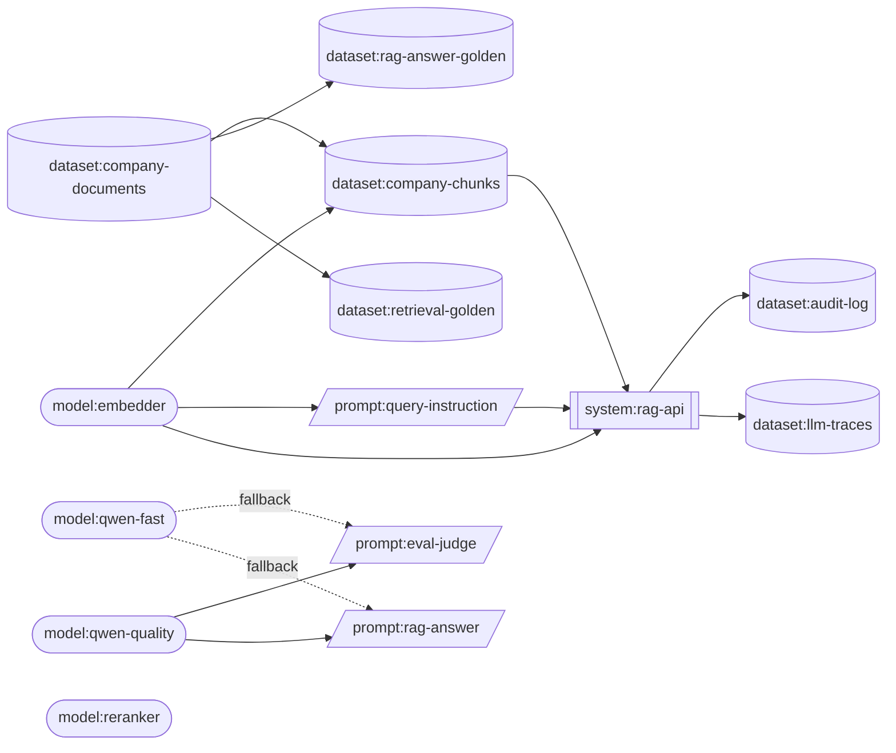

# Cards: models, datasets and systems

<!-- generated from cards/ by `just cards docs`: do not edit -->

| Card | Title | Status | Owner | Last reviewed |
|---|---|---|---|---|
| [dataset:audit-log](dataset-audit-log.md) | Audit log (who received what) | approved | security | 2026-10-12 |
| [dataset:company-chunks](dataset-company-chunks.md) | Company document chunks and vectors (the search indexes) | approved | rag-platform | 2026-10-12 |
| [dataset:company-documents](dataset-company-documents.md) | Company documents (the source corpus) | approved | knowledge-management | 2026-10-12 |
| [dataset:llm-traces](dataset-llm-traces.md) | LLM traces in Langfuse | approved | rag-platform | 2026-10-12 |
| [dataset:rag-answer-golden](dataset-rag-answer-golden.md) | Golden questions and answers for rag-answer | approved | rag-quality | 2026-10-12 |
| [dataset:retrieval-golden](dataset-retrieval-golden.md) | Golden retrieval cases per persona | approved | rag-quality | 2026-10-12 |
| [model:embedder](model-embedder.md) | Qwen3-Embedding-0.6B (embedder) | approved | rag-platform | 2026-10-12 |
| [model:qwen-fast](model-qwen-fast.md) | Qwen3.6-35B-A3B, 4-bit MLX (qwen-fast) | approved | rag-platform | 2026-10-12 |
| [model:qwen-quality](model-qwen-quality.md) | Qwen3.8-27B, 8-bit MLX (qwen-quality) | approved | rag-platform | 2026-10-12 |
| [model:reranker](model-reranker.md) | bge-reranker-v2-m3 (reranker) | approved | rag-platform | 2026-10-12 |
| [system:rag-api](system-rag-api.md) | rag-api (the company knowledge search service) | approved | rag-platform | 2026-10-12 |

## Lineage

