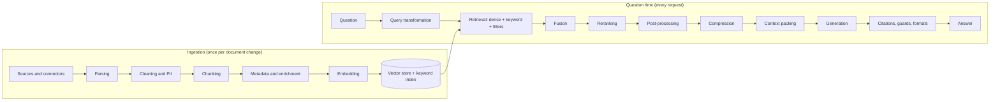
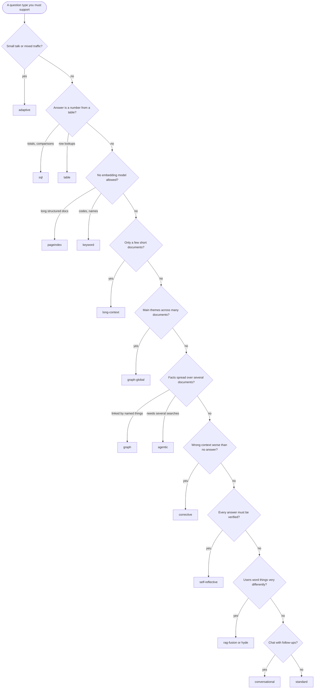

# The decision guide: when to use which

> **IN PLAIN ENGLISH**
> A RAG system is a chain of choices: where documents come from, how they are read and cut up, how
> they are found again, how the answer is written and checked. For almost every link in that chain
> there are several techniques and tools. This guide takes the chain one link at a time and says, for
> each option, **what it is** in one plain sentence, **when to use it**, **when not to**, what it costs,
> and **where it is in this repository** (the component name and the line in `rag.yaml`), or, if it
> isn't here, what to use instead and how to plug it in. It ends with ready-made
> [starter configs](#starter-configs) for common situations.

**Companion pages.** The [RAG handbook](rag-handbook.md) explains each technique in more depth, the
[coverage matrix](coverage-matrix.md) answers "do we have X?" item by item, the
[catalogue](../catalogue.md) lists every component with every setting (generated from the code), and
the [glossary](../glossary.md) defines every term. The build steps that created the parts are
[30–35](../steps/step-30-rag-core-contracts-and-components.md); the techniques added afterwards are the
[extensions](../extensions/README.md).

## How to read this guide

- Every row names a component in `backticks`: that is what goes after `use:` in `rag.yaml`
  (`slot: {use: <name>, <setting>: <value>}`, see [handbook §2](rag-handbook.md#2-how-switching-works)).
  "Status" in the [catalogue](../catalogue.md) says how it is tested: **live** (against the real thing),
  **mocked** (against a stand-in service) or **reference** (written and validated, but needs an extra
  installed, so CI doesn't run it).
- **Cost · speed · quality** uses three words on purpose: *cost* is money and hardware, *speed* is
  how long a person waits, *quality* is how often the answer is right.
- **Five rules** that hold for every section:
  1. Start from the defaults (`offline` / `local` / `production` profiles). They were measured.
  2. Change **one thing at a time**, and measure it on your own questions
     (`rag eval-search`, `rag eval-answers`, `rag eval-compare`, see [Evaluation](#evaluation)).
  3. Fix the **earliest** broken link first: bad parsing can't be fixed by a better reranker.
  4. Prefer the free, deterministic option until numbers show the expensive one pays.
  5. Anything that changes what is *embedded* (chunker, enrichers, embedder) needs a **re-index**;
     anything at question time can be switched for one run with `RAG__<SLOT>__USE=…`.



Contents:
[Sources and connectors](#sources-and-connectors) · [Parsing](#parsing) · [Cleaning and personal data](#cleaning-and-personal-data) ·
[Chunking](#chunking) · [Metadata extraction](#metadata-extraction) · [Enrichment](#enrichment) ·
[Embeddings](#embeddings) · [Similarity metrics](#similarity-metrics) · [Vector indexes](#vector-indexes) ·
[Vector databases](#vector-databases) · [Keyword search and BM25](#keyword-search-and-bm25) ·
[Hybrid search](#hybrid-search) · [Metadata filtering and self-query](#metadata-filtering-and-self-query) ·
[Query transformation](#query-transformation) · [Retrieval and top-k](#retrieval-and-top-k) ·
[Parallel, ensemble and routed retrieval](#parallel-ensemble-and-routed-retrieval) · [Fusion](#fusion) ·
[Reranking](#reranking) · [Post-processing](#post-processing) · [Context compression](#context-compression) ·
[Context packing](#context-packing-and-lost-in-the-middle) · [Generation and prompting](#generation-and-prompting) ·
[Citations and answer formats](#citations-and-answer-formats) · [Abstention and confidence](#abstention-and-confidence) ·
[Streaming](#streaming) · [Conversation memory](#conversation-memory) · [Caching](#caching) ·
[Guardrails](#guardrails) · [RAG architectures](#rag-architectures) · [Agents and MCP](#agents-and-mcp) ·
[Evaluation](#evaluation) · [Observability](#observability) · [Security, governance and compliance](#security-governance-and-compliance) ·
[Deployment and scaling](#deployment-and-scaling) · [Cost and latency levers](#cost-and-latency-levers) ·
[Frameworks](#frameworks) · [Model choices](#model-choices) · [Starter configs](#starter-configs)

---

## Sources and connectors

**The question:** how do documents get into the system, and how does the index stay in step when
they change? Plain idea: a *connector* is a librarian who checks a shelf (a folder, a bucket, a wiki)
and brings back only what is new, changed or gone.

| Option | What it is | Use it when | Avoid it when | Cost · speed · quality | In this repo |
|---|---|---|---|---|---|
| Upload / `rag ingest` | You hand files over, one run | Trying things, one-off loads | The source changes daily | Free · instant · manual | `rag ingest --group hr files…` ([Step 31](../steps/step-31-ingestion-pipeline.md)) |
| `filesystem` | Watches a folder (local, NFS, SMB mount) with per-folder access rules | Shared drives, exported wikis | Files are not on a disk you can mount | Free · polls · exact | `connector: {use: filesystem, root: …}` + `rag sync --watch` ([E04 §12](../extensions/04-evaluation-loops-and-remaining-techniques.md#12-connectors-and-rag-sync)) |
| `s3` | Watches an S3-compatible bucket/prefix (AWS, MinIO, SeaweedFS) by ETag | Documents already land in object storage | You need instant updates (use bucket events → `rag enqueue`) | Cheap · polls or events · exact | `connector: {use: s3, bucket: …}` |
| `web` | A polite crawler (robots.txt, domain allow-list, depth limit) | Public or intranet sites | Pages need a login or are mostly scripts | Reference interface: you implement `list()`/`fetch()` | `connector: {use: web, …}` validates; build it as a plugin ([Step 38](../steps/step-38-reuse-kit-template-sdk-standards.md#3--plugins-a-projects-own-components)) |
| `confluence` · `sharepoint` · `google-drive` | Pull pages/files with their **permissions mapped to groups** | The knowledge lives there | You can't map their permissions to your groups yet (export to a folder instead) | Reference interfaces · the hard part is permission mapping | Same as `web`: declared, validated, implement in your project |
| Event-driven (`rag enqueue`) | The source tells you what changed | Large buckets, near-real-time | Simple shares (polling is easier) | Cheap · seconds · exact | `rag enqueue s3://…`; S3 notifications ([Step 14](../steps/step-14-s3-object-storage-seaweedfs.md)) |

**Keeping track of what was ingested** (so unchanged files are skipped and deleted ones vanish):

| Option | What it is | Use it when | In this repo |
|---|---|---|---|
| `memory` manifest | Remembers in the running process | Tests, demos | `manifest: memory` (offline) |
| `postgres` manifest | Remembers in `rag.ingest_manifest`, shared and durable | Everything real | `manifest: {use: postgres, …}` (local) |
| `memory` queue | Ingestion jobs in process, retried | Tests | `queue: memory` |
| `valkey-streams` queue | Jobs in Valkey Streams: many workers, retries, a dead-letter stream, crash-safe | Big or continuous ingestion | `queue: {use: valkey-streams, url_file: …}` + `rag worker` ([Step 15](../steps/step-15-valkey-cache-queues-locks.md)) |

**Not in this repo:** managed ingestion services (Unstructured platform, LlamaParse/LlamaCloud,
Airbyte/Fivetran connectors). Use them to *export* to a bucket and let `s3` + `rag sync` take it from
there, so the permission labels stay under your control.

## Parsing

**The question:** how is a file turned into text **with its structure** (headings, tables, page
numbers)? Structure matters later: the chunker keeps sections whole and citations can say "page 4".
The parser is picked per file by its detected type; list the ones you allow in `parsers:`.

| Option | What it is | Use it when | Avoid it when | Cost · speed · quality | In this repo |
|---|---|---|---|---|---|
| `markdown` | Reads `.md` headings, lists, tables, code blocks | Wikis, docs-as-code | n/a | Free · fast · exact | `parsers: [markdown, …]` |
| `html` | Reads web pages, drops navigation, footers, scripts | Intranet pages, exports | Script-rendered pages (render first) | Free · fast · good | `html` |
| `pdf` | Reads a PDF's text layer (pypdf) with page numbers; **flags scanned pages** | Digital PDFs | Scans, complex multi-column layouts | Free · fast · good for born-digital | `pdf` (`min_chars_per_page`) |
| `docx` | Reads Word heading styles, lists, tables | Word documents | Old `.doc` (use `tika`) | Free · fast · good | `docx` (extra `docx`) |
| `csv` | One element per row (or N rows) with column names | Spreadsheets, exports | Questions that need totals (use the `sql` architecture) | Free · fast · exact | `csv` |
| `text` | Plain text, paragraphs on blank lines | Logs, notes, source code | n/a | Free | `text` |
| `tika` | Apache Tika server: legacy Office, email, RTF… as text | Odd formats | You need structure (Tika gives text only) | A server · medium | `tika` (mocked) |
| `docling` | Layout-aware parsing with OCR and table structure (IBM Docling) | Scans, forms, complex tables, figures | Plain digital documents (slower, heavy models) | Heavy · slow · best structure | `docling` (reference; `pip install docling`) |

**Not in this repo:** Unstructured.io, LlamaParse, Azure Document Intelligence, Google Document AI,
Amazon Textract. Plug one in as a `parser` plugin that returns the same elements, or run it as a
pre-step that writes Markdown and let `markdown` read it ([ADR-0031](../adr/0031-ingest-through-a-replace-not-append-pipeline.md)).
**Common mistake:** indexing scanned pages as empty text. Check `rag ingest` warnings.

## Cleaning and personal data

**The question:** what noise do we remove, and what personal data must never be stored?
Redaction happens **before** anything is stored, so personal data never reaches an index, cache or log.

| Option | What it is | Use it when | Avoid it when | Cost · speed · quality | In this repo |
|---|---|---|---|---|---|
| `unicode` | Fixes odd characters, hyphenated line breaks, spacing | Always | n/a | Free | `normalizers: [unicode, boilerplate]` |
| `boilerplate` | Drops repeated headers, footers, banners, duplicate paragraphs | PDFs and web pages | Short documents where repeats are content | Free | same |
| `regex` PII | Finds emails, cards, AU TFN/ABN, IBAN, phones, IPs, **checksum-validated** | Always (the default) | You must find names and places too | Free · fast · precise, misses names | `pii: {use: regex, strategy: mask}` |
| `presidio` PII | Microsoft Presidio: adds names and places (NER) | People's names must go | Throughput matters most (slower) | Models · slower · better recall | `pii: {use: presidio}` (reference; extra `presidio`) |
| `mask` | Replaces with `[EMAIL]` | Nobody needs to know who | You need "same person" joins | Free | `strategy: mask` |
| `pseudonymise` | A keyed token: same person → same token | Analytics, joins without identity | You can't keep the key safe | Key management | `strategy: pseudonymise, key_file: …` |
| `remove` | Deletes it | Data minimisation | Answers need to say "contact X" | Free | `strategy: remove` |

**Not in this repo:** cloud DLP (Google Cloud DLP, Amazon Comprehend PII, Azure AI Language PII).
Wrap one as a `pii` plugin; keep `regex` first because it is offline and checksum-exact.

## Chunking

**The question:** how do we cut documents into passages that are small enough to match a question
precisely, but big enough to make sense on their own? Analogy: cutting a book into index cards. Cut
too small and a card says "20 days" without saying of what; too big and the card about leave also
talks about travel. Chunk size is counted in tokens by the `token_counter` slot: `approx` (characters
÷ 4, no files) or `hf-tokenizer` (the embedding model's exact tokenizer, extra `tokenizers`).

| Option | What it is | Use it when | Avoid it when | Cost · speed · quality | In this repo |
|---|---|---|---|---|---|
| `structure` (default) | Cuts at headings; never crosses a section; keeps tables and code whole; records the heading path | Policies, handbooks, wikis, anything with headings | Unstructured text (falls back to sizes) | Free · fast · strong | `chunker: {use: structure, max_tokens: 400, overlap_tokens: 40, min_tokens: 60}` |
| `recursive` | Paragraphs, then sentences, then words, only as fine as needed | Long text without headings | Structured documents (`structure` is better) | Free · fast · good | `chunker: recursive` |
| `fixed` | Every N tokens with overlap | A baseline to beat | Production (splits sentences and tables) | Free · fast · weakest | `chunker: fixed` |
| `sentence-window` | One sentence per chunk; its neighbours are shown to the model | FAQs, short precise facts | Answers need whole sections | More chunks · precise | `chunker: sentence-window` + `postprocessors: [window-expand]` |
| `semantic` | Cuts where the topic changes (sentence embeddings drift apart) | Transcripts, chats, essays | Big corpora on a budget (embeds every sentence) | Slow ingestion · good on unstructured | `chunker: semantic` |
| `parent-child` | Search small children, hand the model their bigger parent | Contracts, manuals: matches need surrounding detail | Short documents | More storage · strong | `chunker: parent-child` + `parent-expand` |
| `hierarchical` | A tree: document > section > subsection > paragraph; leaves know their ancestors | Long manuals with deep headings; "give me the whole subsection" | Flat documents | More metadata · strong | `chunker: hierarchical` + `auto-merge` or `section-expand` ([E02 §1](../extensions/02-chunking-indexing-compression.md#1-chunk-trees-hierarchical-auto-merge-raptor-document-summaries)) |
| RAPTOR | Cluster chunks, summarise clusters, summarise the summaries; index every level | "What is this collection about?" questions | Precise lookups only | An LLM call per cluster | enricher `summary-tree` + `summary-expand` (see [Enrichment](#enrichment)) |
| `proposition` | One self-contained fact per chunk ("The leave allowance is 20 days") | Dense factual prose, precise questions | Large corpora on a budget | LLM per passage, 3–5× chunks · very precise | `chunker: proposition` + `window-expand` |
| Late chunking | Embed the whole document first, then cut, so "it" keeps its meaning | Chunks full of pronouns and references | Short documents; models without long context | Long-context embedder | embedder `late-chunking` (see [Embeddings](#embeddings)) |
| `code` | Source code cut at functions/classes, with symbols and line numbers | Repositories, scripts, SQL | Prose | Free · fast | `chunker: code` |
| Agentic / LLM chunking | A model decides the cut points | Never measured to beat `structure` here | Most cases (cost, non-deterministic) | High | Not in this repo: write a `chunker` plugin, measure against `structure` |

**Rule of thumb:** `structure` first; `parent-child` or `hierarchical` when answers need more than the
matching passage; `sentence-window` or `proposition` when questions are short and exact; `semantic`
for transcripts; `code` for code. Sizes 200–500 tokens with 10% overlap; measure two sizes, not ten.
Every structure-aware chunk also records `heading`, `section_path` and `section_numbers`, which makes
[precise section retrieval](#retrieval-and-top-k) possible.

## Metadata extraction

**The question:** what labels (department, date, type, language, product) does each chunk carry, so
searches can be narrowed? Plain idea: library catalogue cards next to the books.

| Option | What it is | Use it when | Avoid it when | Cost · speed · quality | In this repo |
|---|---|---|---|---|---|
| Given at ingestion | The source system or the uploader says it | It exists already (best) | n/a | Free · exact | `load_source(uri, access, metadata={…})`; connector `rules` |
| `metadata` | Rule-based: dates, language, document type, keywords (TF-IDF/YAKE), codes, money, percentages | You want filters and the documents have none | You need business fields (owner, product) | Free · fast · rule-quality | `enrichers: [context-header, {use: metadata}]` ([E02 §3](../extensions/02-chunking-indexing-compression.md#3-metadata-extraction-at-ingestion)) |
| `llm-metadata` | A model fills a schema you declare; values type- and enum-checked | Business fields: counterparty, product, effective date | Huge corpora on a budget | One LLM call per document · checked | `{use: llm-metadata, fields: {…}}` |
| Entities for a graph | Named things per chunk | Graph RAG | Plain search | See [RAG architectures](#rag-architectures) | `graph-entities`, `llm-entities` |

## Enrichment

**The question:** what extra context do we add to what gets *embedded* (never to what is shown), so
a passage can be found out of context? "Section 4.2: 20 days" means nothing alone; "Annual leave
policy > Entitlement: 20 days" does.

| Option | What it is | Use it when | Avoid it when | Cost · speed · quality | In this repo |
|---|---|---|---|---|---|
| `context-header` (default) | Prepends "Title > Section" | Always | n/a | Free · strong | `enrichers: [context-header]` |
| `llm-context` | **Contextual retrieval**: a model writes one sentence placing the chunk in its document | Transcripts, long unstructured text, recall problems | Well-headed documents (header does most of it) | One LLM call per chunk (prompt caching helps) · +recall | `enrichers: [context-header, llm-context]` |
| `questions` | Adds questions the chunk answers ("hypothetical questions") | FAQ-style use; question/document wording differs | Large corpora on a budget | One LLM call per chunk | `questions` |
| `summary` | One summary per document, indexed as its own chunk | "What is this document about?" | Precise lookups only | One call per document | `summary` + `summary-expand` |
| `summary-tree` | RAPTOR (above) | Broad questions across many chunks | Small corpora | Calls per cluster (extractive offline) | `summary-tree` |
| `graph-entities` · `llm-entities` | Named things (and with `llm-entities`, relations) into the graph store | Graph RAG | Not using a graph | Free / one call per chunk | see [RAG architectures](#rag-architectures) |

## Embeddings

**The question:** which model turns text into vectors (lists of numbers where similar meanings are
close), and how is it used? Analogy: giving every passage GPS coordinates on a "meaning map".

**How to choose a model**, in order: (1) **language** (multilingual if questions or documents are not
all English), (2) **domain** (code, legal, medical models exist), (3) **context length** (≥ your
chunk size; long for late chunking), (4) **quality on a benchmark like yours** (MTEB retrieval
scores are a start, your own `rag eval-search` is the answer), (5) **dimensions** (memory and speed),
(6) **where it runs** (local for privacy, API for convenience), (7) **cost**. Details and gateway
aliases: [E02 §7](../extensions/02-chunking-indexing-compression.md#7-choosing-an-embedding-model-and-switching-it-through-the-gateway).
The platform's default is Qwen3-Embedding-0.6B (1024 dimensions, multilingual) on TEI behind the gateway.

| Option | What it is | Use it when | Avoid it when | Cost · speed · quality | In this repo |
|---|---|---|---|---|---|
| `gateway` | Any embedding model behind LiteLLM (local TEI or OpenAI, Cohere, Voyage, Jina, Mistral, Gemini, Bedrock) | Always in real use | Tests (use `hashing`) | Depends on model | `embedder: {use: gateway, model: embedder, dimensions: 1024}` |
| `hashing` | Deterministic word-hash vectors, no model | Tests, CI, offline demos | Production (readiness refuses it) | Free · instant · weak | `embedder: {use: hashing}` |
| `cached` | Wrapper: the same text is never embedded twice (Valkey: shared across replicas) | Always in real use | n/a | Saves calls | `{use: cached, store: valkey, inner: {…}}` |
| `batched` | Wrapper: fixed batches, requests-per-second ceiling, retries | Big re-indexes against a rate-limited API | Small loads | Slower but never fails at 40% | `{use: batched, batch_size: 64, requests_per_second: 5, inner: {…}}` |
| `instructed` | Adds the model's **instruction prefixes** ("query: " / "passage: ") | e5, bge, nomic, gte, mxbai, snowflake, Qwen3 models | Models without prefixes | Free · +recall when the model expects them | `{use: instructed, preset: e5, inner: {…}}` |
| `matryoshka` | Keeps the first N dimensions of a Matryoshka-trained model | Index too big, model supports it | Models not trained for it (quality collapses) | Smaller, faster · small loss | `{use: matryoshka, dimensions: 256, inner: {…}}` or `request_dimensions: true` |
| `late-chunking` | Embeds the whole document, pools per chunk | Pronoun-heavy text, long-context models | Short chunks that stand alone | Long-context model | `embedder: {use: late-chunking, backend: tei, …}` |
| **Dense** vectors | One vector per chunk, meaning-based | Paraphrases, synonyms | Exact codes and names | The default | the embedders above |
| **Sparse** vectors | A weight per word (BM25) or per learned word (SPLADE) | Exact terms inside a vector DB; SPLADE adds related words | You already run a keyword engine | Cheap / a SPLADE model | `sparse_embedder: bm25` or `splade-tei` with `keyword_index: sparse` / `qdrant-sparse` |
| **Multi-vector** (late interaction) | A vector per token; scores by best match per word (MaxSim) | Fine-grained matching, long passages | Memory-tight systems | Many vectors · strong reranker | rerankers `maxsim` (offline), `colbert` (reference) |
| **Quantization** | Store vectors in fewer bits (half, 8-bit, 1-bit) | Memory pressure, large corpora | Tiny corpora (no need) | ~2–32× smaller · small loss, rescoring recovers | pgvector `vector_type: halfvec`, `quantization: binary`; Qdrant `quantization: scalar \| binary` |

**The embedding contract:** model, revision, dimensions, normalisation and prefixes must be the same
at indexing and at search. Changing any of them means a new collection and `rag reindex`
([Step 36](../steps/step-36-lifecycle-threat-model-compliance.md)).
**Not in this repo:** fine-tuning an embedding model on your data (sentence-transformers training;
worth it only after hybrid + reranking are tuned), image/multimodal embeddings (CLIP, ColPali).

## Similarity metrics

**The question:** how do we measure "how close" two vectors are? Analogy: comparing two arrows by the
**angle** between them (cosine), by angle *and* length (dot product), or by the distance between their
tips (Euclidean / Manhattan).

| Metric | What it is | Use it when | Avoid it when | In this repo |
|---|---|---|---|---|
| Cosine (default) | Angle only; length ignored | The model card says cosine or "normalised" (most text models, including Qwen3-Embedding) | The model was trained for raw inner product | `vector_store: {…, metric: cosine}` |
| Dot (inner product) | Angle × lengths; longer vectors score higher | The model card says dot / maximum inner product and vectors are **not** normalised | Vectors are normalised (then dot = cosine, just faster) | `metric: dot` |
| Euclidean (L2) | Straight-line distance between tips | Image and older models trained with L2 | Text models trained for cosine | `metric: l2` |
| Manhattan (L1) | Distance along the grid (sum of differences) | A model or research result that needs it | Most cases; OpenSearch supports it only on flat indexes | `metric: l1` (pgvector, Qdrant, memory) |

**Normalisation:** if vectors are scaled to length 1, cosine, dot and L2 give the **same order**, so
pick dot for speed. The platform's embedder returns normalised vectors. **No metric is "better":
only the one the model was trained with is right.** Changing it is a re-index; the store refuses to
search an index built for another metric (`rag index ddl` prints the right index).
Details: [E01 §1](../extensions/01-retrieval-math-filters-fusion.md#1-similarity-metrics-index-settings-and-the-embedding-contract).

## Vector indexes

**The question:** how does the database find the nearest vectors without comparing against all of
them? Analogy: a flat index reads every card; HNSW is a map of shortcuts between neighbouring cards;
IVF first sorts cards into drawers and only opens the closest drawers.

| Index | What it is | Use it when | Avoid it when | Tuning knobs | In this repo |
|---|---|---|---|---|---|
| Flat (exact) | Compares with every vector | < ~50k chunks, audits needing perfect recall | Large corpora (slow) | none | `index_type: flat` (pgvector, Qdrant, OpenSearch); `memory` store is always exact |
| HNSW (default) | A layered graph of shortcuts | Almost everything | Very write-heavy tiny indexes | `hnsw_m` (links per node: recall and memory), `ef_construction` (build quality), `ef_search` (query recall vs speed) | `index_type: hnsw, hnsw_m: 16, ef_construction: 64, ef_search: 80` |
| IVF (`ivfflat`) | Clusters ("lists"); search the closest `probes` | Fast builds, memory-tight, bulk loads | Data that drifts a lot (re-train lists) | `lists` (≈ rows/1000), `probes` (recall vs speed) | pgvector `index_type: ivfflat, lists: 100, probes: 10` |
| Filtered search | Applying a filter *during* the graph walk | Selective filters (one department) | n/a | pgvector `iterative_scan`; Qdrant `metadata_indexes`; OpenSearch efficient filtering | on by default |
| DiskANN / IVF-PQ / ScaNN | Indexes for billions of vectors on disk or compressed | Hundreds of millions+ | Below that (HNSW is simpler) | engine-specific | Not in this repo: pgvectorscale, Milvus, Vertex AI Vector Search |

**Tuning order:** raise `ef_search` first (no rebuild), then `hnsw_m` / `ef_construction` (rebuild),
and measure recall with `rag eval-search` before and after.

## Vector databases

**The question:** where do the vectors live? The platform's rule ([ADR-0011](../adr/0011-use-postgres-with-pgvector-as-the-primary-document-and-vector-store.md),
[ADR-0012](../adr/0012-use-qdrant-as-a-derived-vector-index-alongside-postgres.md)): Postgres is the
system of record; dedicated engines are *derived indexes* you can rebuild. Every store applies the
permission filter **inside** its query and passes the same conformance tests (including leak tests).

**In this repository:**

| Option | What it is | Use it when | Avoid it when | In this repo |
|---|---|---|---|---|
| `pgvector` (local default) | Vectors in Postgres next to the documents and permissions | Up to tens of millions of chunks; one database to run | Hundreds of millions, or vector-heavy multi-tenant load | `vector_store: {use: pgvector, …}` ([Step 11](../steps/step-11-postgres-pgvector.md)) |
| `qdrant` | A dedicated vector database: payload filters, quantization, sparse vectors | Scale, quantization, filtering speed | You want one fewer service | `local-engines` profile ([Step 12](../steps/step-12-qdrant-vector-database.md)) |
| `opensearch-knn` | k-NN inside OpenSearch (lucene/faiss/nmslib engines) | You already run OpenSearch for keywords | You don't need OpenSearch otherwise | `vector_store: {use: opensearch-knn, …}` ([Step 13](../steps/step-13-opensearch-keyword-hybrid-search.md)) |
| `memory` | Exact search in the process | Tests, demos, tiny corpora | Anything shared or persistent | `vector_store: memory` (offline) |

**In the wider ecosystem** (not in this repository; each would be a `vector_store` plugin that passes
`rag_core.testing.conformance` (`check_vector_store`, `check_access_update`, `check_metadata_filters`,
`check_metrics`), registered from your project ([Step 38](../steps/step-38-reuse-kit-template-sdk-standards.md#3--plugins-a-projects-own-components))):

| Engine | What it is | When it wins | Watch out |
|---|---|---|---|
| Weaviate | Open-source vector DB with built-in hybrid search and vectoriser modules | You want hybrid + embedding modules in one engine; multi-tenancy built in | Another source of truth for permissions; its modules duplicate the gateway |
| Milvus / Zilliz Cloud | Distributed vector DB, many index types (IVF-PQ, DiskANN, GPU) | Billions of vectors, GPU indexes, a team to run clusters (or Zilliz managed) | Heavy to operate for small corpora |
| Pinecone | Fully managed, serverless vector DB | No ops team, fast to start, scales to zero | Data leaves your network; cost at high query volume; vendor lock-in |
| Chroma | Simple embedded/lightweight vector store | Prototypes, notebooks, single-user apps | Enterprise permissions, scale, HA |
| LanceDB | Embedded, columnar (Lance format) on local disk or object storage | Edge/desktop apps, multimodal data, larger-than-memory on S3 | Many concurrent writers |
| Elasticsearch | Search engine with BM25, dense kNN, ELSER sparse and an RRF retriever | You already run Elastic | Licence terms; the platform's OpenSearch fills the same role |
| Vespa | Search and ranking engine with tensors and multi-phase ranking (ColBERT-style built in) | Very large scale with custom ranking logic | Learning curve |
| Redis (query engine / vector sets) | In-memory vector search in Redis | Lowest latency, small-to-medium hot sets, Redis already there | Memory cost for big corpora (Valkey here is used for caches, not vectors) |
| MongoDB Atlas Vector Search | Vectors next to your operational MongoDB documents | The data already lives in MongoDB | Not self-hosted in the same way |
| Azure AI Search | Managed hybrid search with a semantic ranker and integrated vectorisation | Azure shops; security trimming by filter fields | A different API: its own adapter and conformance run ([cloud mapping](../architecture/cloud-mapping.md)) |
| Vertex AI Vector Search | Google's managed ANN (ScaNN) at very large scale | GCP, huge corpora, low latency | Filters and hybrid differ from the platform's model |
| Bedrock Knowledge Bases | Managed end-to-end RAG on AWS (ingest, chunk, embed, store, retrieve) | AWS teams who want RAG without running it | Less control over each stage; evaluation and permissions are theirs, not this platform's |
| Turbopuffer | Serverless vector + full-text search on object storage | Very many tenants/namespaces, mostly cold data, low storage cost | Cold queries are slower than in-memory engines |

**Choosing:** start with `pgvector`; move to `qdrant` (or `opensearch-knn` if OpenSearch already runs)
when memory, filtering speed or scale demand it; consider a managed service only when the operations
saving is worth the data leaving and the lock-in.

## Keyword search and BM25

**The question:** how do we find passages that contain the **exact words** (error codes, part numbers,
names)? BM25 scores a passage higher when it contains rare question words, more than once, and is not
padded with other text.

| Option | What it is | Use it when | Avoid it when | In this repo |
|---|---|---|---|---|
| `postgres-fts` (local default) | Postgres full-text search on the same tables | One database to run | You need custom analysers, synonyms at index time | `keyword_index: {use: postgres-fts, text_search_config: english}` (`simple` for many languages) |
| `opensearch` | OpenSearch BM25 with analysers and synonyms | Codes, multilingual analysers, big corpora | Small corpora | `local-engines` profile |
| `memory-bm25` | BM25 in memory | Tests | Anything real | `keyword_index: memory-bm25` (offline) |
| `sparse` | Sparse-vector search in memory using the `sparse_embedder` | Trying SPLADE vs BM25 offline | Production | `keyword_index: sparse` + `sparse_embedder: bm25` |
| `qdrant-sparse` | BM25 or SPLADE sparse vectors inside Qdrant | Qdrant-only stacks | You already run OpenSearch | `keyword_index: {use: qdrant-sparse, …}` |
| `bm25` / `splade-tei` | Sparse embedders: classic word weights / learned word weights that also add related words | `splade-tei` when keyword search misses synonyms | `splade-tei` without a GPU budget | `sparse_embedder: {use: splade-tei, url: …}` |

**Vectorless RAG** (no embeddings at all): `pipeline: keyword`, or `pageindex` (see [RAG architectures](#rag-architectures)).

## Hybrid search

**What it is:** run meaning search (dense) and word search (keyword) **in parallel** and merge the
lists. **Why:** dense finds "WFH" for "remote work"; keyword finds "E-4021". Enterprise documents need
both. **Use it:** almost always (it is the default). **Avoid it:** only when measured that one side
adds nothing, or you have no embedding model.
**Cost:** two searches per query (in parallel, so latency ≈ the slower one).
**In this repo:** `retriever: {use: hybrid, candidates: 30}` + `fusion: {use: rrf}`; weights via
[Fusion](#fusion). **Not in this repo:** engine-native hybrid queries (OpenSearch hybrid query,
Qdrant Query API, Weaviate `hybrid`) that fuse inside one engine. They save a round trip but tie
you to one engine; revisit per [ADR-0032](../adr/0032-search-through-a-switchable-hybrid-pipeline.md).

## Metadata filtering and self-query

**What it is:** narrowing a search to documents whose labels match ("only HR, updated this year").
Filters are applied **inside** each store's query and always ANDed with the permission filter, so a
filter can narrow but never widen.

| Option | What it is | Use it when | Avoid it when | In this repo |
|---|---|---|---|---|
| Request filter | The caller sends the filter | The UI has a department picker, an API caller knows the scope | People type conditions in free text | `rag search --filter department=hr`; `"filter"` in `/v1/search` and `/v1/answer`; `filters=` in the SDK |
| Operators | eq, ne, in, nin, gt/gte/lt/lte, range, exists, and/or/not | Dates, versions, lists | n/a | [E01 §2](../extensions/01-retrieval-math-filters-fusion.md#2-metadata-filters) |
| `self-query` | Pulls a filter out of the question ("HR policies updated after 2025") against a declared schema; rules or an LLM; retries without it if nothing matches | People write conditions into questions | No metadata to filter on | `query_transformer: {use: self-query, mode: rules, fields: {…}}` |
| Rolling dates | "in the last 6 months" → a date range | Time-bound questions | n/a | `self-query` with `date_field` ([E04 §9](../extensions/04-evaluation-loops-and-remaining-techniques.md#9-query-clean-up-synonyms-translation-time)) |

**Watch out:** a very selective filter on an approximate index can return fewer than k results; index
the filtered fields (Qdrant `metadata_indexes`) and keep pgvector's `iterative_scan` on.

## Query transformation

**The question:** should the question be changed before searching? Analogy: a librarian who
rephrases your question before walking to the shelves.

| Option | What it is | Use it when | Avoid it when | Cost · speed · quality | In this repo |
|---|---|---|---|---|---|
| `identity` | Search with the question as asked | Search APIs, low latency | Chat follow-ups | Free | `query_transformer: identity` |
| `with-history` | Prepends the last user turns | Cheap follow-ups | Long rambling chats | Free | offline default |
| `rewrite` | A model turns "and for part-timers?" into a standalone question | Chat assistants | Single-shot search | 1 call (only with history) | `{use: rewrite, llm_slot: llm}` (local default) |
| `multi-query` | A model writes N paraphrases; each searched, then fused | Users word things differently from documents | Tight latency/cost | N calls + N searches · +recall | `{use: multi-query, n: 3}`; as a pipeline `rag-fusion` |
| `hyde` | A model writes a hypothetical answer; that is searched | Short questions, long documents | Facts the model would hallucinate wildly | 1 call | `{use: hyde}`; pipeline `hyde` |
| `step-back` | Adds a more general question ("what are the leave rules?") | Questions needing principles | Simple lookups | 1 call | `step-back` |
| `decompose` | Splits "X and Y?" into parts | Compound questions | Simple questions | 1 call + searches | `decompose` |
| `expand-terms` | Adds known synonyms/acronyms ("MFA" → "multi-factor authentication") from a glossary | Company jargon | No glossary | Free | `{use: expand-terms, file: glossary.yaml}` |
| `normalize` | Cleans spacing/Unicode, fixes misspellings against the corpus words | Typos ("anual leeve") | n/a | Free | `normalize` (first in a chain) |
| `translate` | Adds the question in the corpus language | Questions in other languages, keyword search | A multilingual embedder alone suffices | Free (glossary) / 1 call (llm) | `{use: translate, target: en, mode: llm}` |
| `self-query` | Extracts a metadata filter | see [above](#metadata-filtering-and-self-query) | | | `self-query` |
| `chain` | Several in order | Combining (normalize → rewrite → multi-query) | Stacking without measuring | Sum of parts | `{use: chain, steps: [normalize, {use: rewrite}]}` |
| Routing | Send the question to the right index or pipeline | Separate collections, mixed traffic | One index | Rules free / 1 call | `retriever: router`; `pipeline: adaptive` |

## Retrieval and top-k

**The question:** how many candidates do we fetch, and how many reach the model?
Analogy: pull 30 books off the shelf (candidates), let an expert pick the best 8 (rerank, `search_k`).

| Option | What it is | Use it when | In this repo |
|---|---|---|---|
| `dense` | Vector search only | Measuring dense alone; no keyword index | `retriever: dense` |
| `keyword` | Keyword search only | No embeddings; codes dominate | `retriever: keyword` |
| `hybrid` | Both, fused | Default | `retriever: hybrid` |
| `section` | **Precise section retrieval**: "section 4.2" or a heading title → that exact section first, then the usual results | Legal, standards, policies cited by number | `retriever: {use: section, inner: {use: hybrid}}` ([E02 §4](../extensions/02-chunking-indexing-compression.md#4-exact-sections)) |
| `candidates` | How many each search returns before fusion/rerank | 20–50; more if the reranker is good | `retriever: {use: hybrid, candidates: 30}` |
| `top_n` | How many the reranker re-reads | Same as candidates (30) | `reranker: {…, top_n: 30}` |
| `search_k` | How many passages the model finally sees | 5–10 for chat; more for research | `pipeline: {use: standard, search_k: 8}` |

**Sizing rule:** recall comes from *candidates*, precision from the *reranker*, and cost from
*search_k*. If the right passage is never in the top 30, no reranker can save it (fix chunking or
hybrid first); if it is at position 20, reranking helps; if the model gets confused, lower `search_k`
or add `min-score`.

## Parallel, ensemble and routed retrieval

| Option | What it is | Use it when | Avoid it when | In this repo |
|---|---|---|---|---|
| Parallel searches | Dense and keyword (and multi-query variants) run at the same time | Always | n/a | `parallel: true` (default) on retrievers and `rag-fusion` |
| `ensemble` | Several retrievers (another collection, model or profile) in parallel, fused with weights | A second collection (archive), comparing models, mixing BM25 + SPLADE + dense | One index answers everything | `retriever: {use: ensemble, members: […]}` |
| `router` | Picks the right index per question (keywords or an LLM) | One index per department, language, product | One index | `retriever: {use: router, routes: {…}}` ([E01 §4](../extensions/01-retrieval-math-filters-fusion.md#4-the-router)) |
| Multi-query / RAG-Fusion | Several phrasings searched in parallel | Varied wording | Latency budgets | `pipeline: rag-fusion` |

## Fusion

**The question:** dense and keyword scores are on different scales; how do we merge the lists?
Analogy: two judges score on different scales; you either compare their **rankings** or rescale their
**scores** first.

| Option | What it is | Use it when | Avoid it when | In this repo |
|---|---|---|---|---|
| `rrf` (default) | **Reciprocal rank fusion**: each list gives 1/(k + rank); uses ranks only | No labelled data; robust default | You have measured one side deserves more | `fusion: {use: rrf, k: 60}` |
| `relative-score` | **Relative score fusion**: rescale each list to 0..1, then alpha × dense + (1 − alpha) × keyword (Weaviate style) | Tuning with one number | Scores with outliers | `fusion: {use: relative-score, alpha: 0.7}` |
| `weighted` | Same maths with a weight per list | Code-heavy content: keyword deserves more | Untested weights | `fusion: {use: weighted, weights: {dense: 1, sparse: 2}}` |
| `dbsf` | Distribution-based: rescale by mean ± 3 standard deviations (Qdrant style) | Score spreads differ wildly | Few results per list | `fusion: dbsf` |
| `combsum` | Rescaled scores added | Agreement and score size both matter | Lists of very different quality | `fusion: {use: combsum, normalize: minmax}` |
| `combmnz` | CombSUM × number of lists that found it (rewards agreement) | Several similar retrievers voting (ensembles) | Two lists only | `fusion: combmnz` |
| `borda` | Points by position (N, N−1, …) | Ranks only, more weight mid-list than RRF | Long tails of noise | `fusion: borda` |

Comparison with worked numbers: [E01 §3](../extensions/01-retrieval-math-filters-fusion.md#3-fusion-the-result-cache-and-the-ensemble).

## Reranking

**The question:** after a fast but rough search, who reads the top candidates carefully *together
with the question* and re-orders them? Usually the single biggest quality gain after hybrid search.

| Option | What it is | Use it when | Avoid it when | Cost · speed · quality | In this repo |
|---|---|---|---|---|---|
| Cross-encoder via gateway | A model reads question + passage together and scores relevance | Default for real use | Ultra-low latency | GPU/CPU · +50–200 ms · big gain | `reranker: {use: gateway, model: reranker, top_n: 30}` (bge-reranker-v2-m3 on TEI) |
| `tei` | The same, straight to TEI (no gateway budgets or logs) | Tests, bypassing the gateway | Production (governance) | Same | `reranker: {use: tei, url: …}` |
| `cross-encoder` | In-process (sentence-transformers) | No reranker server | Small app memory | App memory | `cross-encoder` (reference) |
| `llm` | **LLM listwise**: a chat model orders the list | Few candidates, hard reasoning | Many candidates, cost-sensitive | High · slow · strong | `reranker: {use: llm, top_n: 10}` |
| `maxsim` | ColBERT-style **MaxSim** over hashed token vectors, offline | Trying late interaction offline | Production quality | Free | `reranker: maxsim` |
| `colbert` | A real ColBERT model (PyLate) | Token-level matching, long passages | Memory-tight | Model in process | `reranker: colbert` (reference) |
| `term-overlap` | Offline stand-in | Tests and CI only | Production (readiness warns) | Free | offline default |
| API rerankers (Cohere Rerank, Voyage rerank, Jina Reranker) | Hosted cross-encoders | No GPU, multilingual needs | Data must stay inside | Per-call price | Not a separate component: add a gateway alias and use `gateway` (it calls `/rerank`) |

All rerankers **fail open**: if the reranker is down, the fused order is used and the failure counted.

## Post-processing

**The question:** after ranking, how do we shape the final list? These run in order.

| Option | What it is | Use it when | Avoid it when | In this repo |
|---|---|---|---|---|
| `dedupe` | Drops near-duplicates | Many copies/versions | n/a | `{use: dedupe, threshold: 0.85}` |
| `min-score` | Drops candidates below a score | To make "I don't know" possible | Uncalibrated scores (measure first) | `{use: min-score, stage: rerank, threshold: 0.05}` |
| `max-per-document` | Caps chunks per document | One long document crowds out others | Single-document questions | `{use: max-per-document, n: 3}` |
| `mmr` | **Maximal marginal relevance**: relevant **and** different | Broad questions, overviews | Precise lookups | `{use: mmr, lambda_: 0.7}` |
| `recency` | Blends relevance with freshness (half-life) | Policies that change; `when: asked` for "latest/current" | Timeless content | `{use: recency, weight: 0.3, when: asked}` |
| `parent-expand` | Swaps a matched child for its parent | With `parent-child` | Other chunkers | `parent-expand` |
| `window-expand` | Swaps a sentence for its window | With `sentence-window`, `proposition` | Other chunkers | `window-expand` |
| `section-expand` | Replaces a hit with its whole section (token budget) | "Give me the whole rule" | Short answers | `{use: section-expand, max_tokens: 1200}` |
| `auto-merge` | Enough children of one parent found → return the parent | With `hierarchical` | Other chunkers | `{use: auto-merge, threshold: 0.5}` |
| `summary-expand` | A retrieved summary brings its document's best chunks | With `summary` / `summary-tree` | n/a | `summary-expand` |

## Context compression

**The question:** can we send the model **less text** without losing what matters? Fewer tokens =
cheaper, faster, and less distraction. Runs after the context guards, before packing.

| Option | What it is | Use it when | Avoid it when | Cost · speed · quality | In this repo |
|---|---|---|---|---|---|
| `extractive` | Keeps sentences sharing words (or meaning) with the question | Long chunks, short answers | Answers need surrounding nuance | Free | `compressors: [{use: extractive, threshold: 0.3}]` |
| `embedding-filter` | Drops chunks/sentences below a similarity threshold | Many weak candidates | Few candidates | Embeddings | `{use: embedding-filter, threshold: 0.3}` |
| `llm-extract` | A model copies only relevant sentences (verified against the chunk) | Big savings justify a call | Latency budgets | 1 call per chunk | `{use: llm-extract}` |
| `summarize` | A question-focused summary of long chunks (kept only if grounded) | Very long chunks | Exact wording matters (legal) | 1 call per long chunk | `summarize` |
| `llmlingua` | Drops uninformative tokens (LLMLingua-2) | Very long contexts, local model available | Citations must quote exactly | Local model | `llmlingua` (reference) |
| `compress: true` | A light built-in sentence filter in the context builder | Quick win | n/a | Free | `context_builder: {…, compress: true}` |

## Context packing and lost-in-the-middle

**What it is:** deciding what the model sees and in what order, within a token budget. Each passage
goes into a numbered `<doc id="n">` block (a passage can't forge another's markers).

| Option | Use it when | In this repo |
|---|---|---|
| `numbered`, `order: relevance` (default) | Most cases | `context_builder: {use: numbered, max_tokens: 3000, order: relevance}` |
| `order: lost-in-middle` | Long contexts: models attend less to the middle, so best go first and last | `order: lost-in-middle` |
| `order: document` | Narrative or legal text read in order | `order: document` |
| `max_tokens` / `max_chunk_tokens` | Budget per answer / per passage | settings on `numbered` |
| Whole documents | A few short documents answer most questions | `pipeline: long-context` |

## Generation and prompting

| Option | What it is | Use it when | Avoid it when | In this repo |
|---|---|---|---|---|
| `llm` generator | The registered, versioned prompt `rag-answer` on the answer model | The product | n/a | `generator: {use: llm, llm_slot: answer_llm, prompt: rag-answer, prompt_label: production}` |
| `extractive` generator | No model: quotes the best sentences with citations | Offline, demos, model outage | Real users (readiness warns) | `generator: extractive` |
| Prompt registry | Prompts as versioned, locked, promoted files | Always | n/a | `just prompts new / lock / promote` ([Step 24](../steps/step-24-prompt-registry.md)) |
| Two model slots | A fast helper (`llm`) and a quality answer model (`answer_llm`) | Always: rewriting doesn't need the big model | n/a | `llm`, `answer_llm`, `judge_llm` slots |
| Prompt optimisation (DSPy, etc.) | Tuning prompts automatically against a metric | A stable eval set exists | No eval set | Not in this repo: optimise offline, then register the winner as a prompt version |

## Citations and answer formats

| Option | What it is | Use it when | In this repo |
|---|---|---|---|
| Checked `[n]` citations | Markers pointing at nothing are removed and counted | Always | built in ([ADR-0033](../adr/0033-answer-with-checked-citations-and-abstention.md)) |
| `uncited: flag / abstain / keep` | What happens to an answer citing nothing | `abstain` in production, `flag` in dev | `pipeline: {…, uncited: abstain}` |
| `citations` | Inline `[doc n]` or footnotes `[^n]`, with the supporting quote and character offsets | UIs that highlight sources; printed answers | `answer_formatters: [{use: citations, style: footnotes}]` |
| `json` | A schema-checked answer object, optional extracted fields | Another program reads the answer | `answer_formatters: [json]` |
| `confidence` | 0..1 score from support, citations and coverage | Showing how sure it is | `answer_formatters: [confidence]` |
| `follow-ups` | Questions the shown sources can answer | Helping people continue | `answer_formatters: [follow-ups]` |

## Abstention and confidence

**What it is:** saying "I don't know based on the documents" instead of guessing.

| Option | Use it when | In this repo |
|---|---|---|
| No hits → no model call | Always (cheaper, no invention) | `abstain_without_hits: true` (default) |
| `min-score` on rerank | To make "nothing relevant" a real outcome | `postprocessors: [{use: min-score, stage: rerank, threshold: 0.05}]` |
| `uncited: abstain` | Regulated or customer-facing answers | `production` profile |
| `confidence` with `abstain_below` | After calibrating scores on your questions | `{use: confidence, abstain_below: 0.4}` |
| `corrective` / `self-reflective` architectures | Wrong context is worse than none | see [RAG architectures](#rag-architectures) |
| `groundedness` guard `on_hit: block` | Every sentence must be supported | see [Guardrails](#guardrails) |

## Streaming

| Option | What it is | Use it when | Avoid it when | In this repo |
|---|---|---|---|---|
| `stream: live` | Words appear as they are written; output guards run on the final answer | Internal assistants, best perceived speed | Regulated output | `pipeline: {…, stream: live}` |
| `stream: checked` | Nothing shown until the output guards pass | Production, customer-facing | Speed matters more than checks | `production` profile |

Both use server-sent events: `rag ask --stream`, `POST /v1/answer {"stream": true}`.

## Conversation memory

| Option | What it is | Use it when | In this repo |
|---|---|---|---|
| `memory` | Turns in process memory | Dev, tests | `memory: {use: memory, max_turns: 10}` |
| `valkey` | Turns in Valkey, shared by replicas, expiring | Every multi-replica deployment | `memory: {use: valkey, ttl_seconds: 86400}` |
| `none` | No memory | Single-shot search tools | `memory: none` |
| Conversational RAG | Memory + a history-aware transformer | Chat | `pipeline: conversational`, or `rewrite` / `with-history` |

Memory is keyed by tenant + person + session; `rag erase-subject` deletes a person's conversations.
**Not in this repo:** long-term user memory (facts remembered across sessions). Deliberately out of
scope for privacy; build it as a separate, consented store if needed.

## Caching

**The question:** what work can be reused? Five different caches, from the bottom up:

| Cache | Reuses | Use it when | Avoid it when | Risk | In this repo |
|---|---|---|---|---|---|
| Embedding cache | The vector of a text already embedded | Always (re-ingestion, repeated queries) | n/a | None (same model only) | `embedder: {use: cached, store: valkey, inner: {…}}` |
| Search-result cache | The hits of the same search by someone with the same access | Repeated searches (help desks, dashboards) | Every query unique | Stale only if data changed outside ingestion | `search_cache: {use: valkey, ttl_seconds: 600}` (`memory` per process) |
| Exact answer cache | The answer to the same question, same access, same settings | Repeated questions | Personalised answers | Low (index epoch invalidates on every change) | `cache: {use: valkey}` (`memory` in tests) |
| Semantic cache | The answer to a question with nearly the same meaning | High-volume FAQs, after measuring false hits | Regulated advice; near-identical questions with different answers ("primary" vs "secondary carers") | **False hits** | `cache: {use: semantic, threshold: 0.95}` |
| Provider prompt / KV caching | The model server reuses the computed start of a prompt | Long fixed system prompts, repeated documents | n/a | None (never changes answers) | Model-server feature, not a component ([E04 §11](../extensions/04-evaluation-loops-and-remaining-techniques.md#11-prompt-caching-and-kv-caching-notes-for-providers)): keep the prompt prefix stable |

Every key includes the person's **access fingerprint** and an **index epoch**, so two people with
different access never share a cached answer, and a changed document empties the caches at once.

## Guardrails

**The question:** what checks stop misuse and bad answers? Checks run at three stages (input,
retrieved context, output) and return allow, flag, redact or block. Measured in CI with
`just guard-eval` (≥ 95% of attacks caught, ≤ 5% ordinary questions stopped).

| Guard | Stage | What it catches | Use it when | In this repo |
|---|---|---|---|---|
| `size` | input | Huge or degenerate inputs | Always | `{use: size, max_chars: 2000}` |
| `injection` | input | Prompt injection, jailbreak patterns | Always | `{use: injection, threshold: 0.6}` |
| `pii` | input/output | Personal data in questions or answers | Always | `{use: pii, stage: input}` |
| `topics` | input | Denied topics (legal, medical, investment advice) | Policies forbid them | `{use: topics}` |
| `context-injection` | context | Retrieved documents that give orders (indirect injection) | Always | `{use: context-injection}` |
| `groundedness` | output | Sentences (and numbers) the sources don't support | Always; `on_hit: block` for regulated | `{use: groundedness, on_hit: flag}` |
| `secrets` | output | Keys, tokens, passwords | Always | `{use: secrets}` |
| `toxicity` | output | Toxic language (word list baseline) | Public-facing | `{use: toxicity}` |
| `llm-judge` | any | A model classifies against safety categories (Llama Guard style) | Rephrased attacks patterns miss | `{use: llm-judge, stage: input}` (uses `judge_llm`) |
| `webhook` | any | Any external guard service over HTTP (`{stage, text}` → `{action, reasons}`) | A vendor or central safety team | `{use: webhook, url: …}` |

**External tools** (none built in; all plug in through `llm-judge` or `webhook`):

| Tool | What it is | When it wins | How to plug in |
|---|---|---|---|
| Llama Guard (Meta) | An open safety-classifier model | Local, private model-based moderation | Serve it behind the gateway, point `judge_llm` at it, `llm-judge` |
| NeMo Guardrails (NVIDIA) | Programmable dialogue rails (Colang) | Conversation-flow rules, topical rails | Run as a service; small adapter to the `webhook` contract |
| Guardrails AI | Validators for outputs (schemas, PII, competitors…) | Output validation with a validator hub | Its server behind an adapter → `webhook` |
| Lakera Guard | Hosted prompt-injection and data-leak detection API | Strong injection detection without running a model | `webhook` adapter (data leaves the network) |
| Microsoft Presidio | PII detection and anonymisation | Names and places | `pii: {use: presidio}` at ingestion (reference) |
| Azure AI Content Safety | Hosted harm categories and Prompt Shields | Azure deployments | `webhook` adapter |
| Amazon Bedrock Guardrails | Hosted content filters, denied topics, PII, grounding checks | AWS deployments | `webhook` adapter calling the ApplyGuardrail API |

Model-based and webhook guards **fail open** by default (`fail_closed: false`); set `fail_closed: true`
where a missed check is worse than an outage. Decision: [ADR-0034](../adr/0034-layered-guardrails-measured-in-ci.md).

## RAG architectures

**The question:** what is the overall strategy for answering? The `pipeline` slot picks it; all of
them share memory, guards, caches, the access post-check, context packing, citation checks and audit.

| Architecture | In plain words | Use it when | Avoid it when | Cost | In this repo |
|---|---|---|---|---|---|
| `naive` | Dense top-k, straight to the model | A baseline to beat | Production | Lowest | `pipeline: naive` |
| `standard` (default) | "Advanced RAG": configured search, rerank, pack, generate, cite | Most projects | n/a | Moderate | `pipeline: standard` |
| `vector` | **Vector RAG**: dense search only, with reranker and post-processors | No keyword index; measuring dense | Codes and names matter | Like standard | `pipeline: vector` |
| `keyword` | **Vectorless RAG** by keywords: BM25 only, reranked | No embedding model allowed; exact codes | Paraphrased questions | Lowest | `pipeline: keyword` |
| `pageindex` / `vectorless` | A model walks each document's table of contents and reads the chosen sections | Long, well-structured documents; explainable retrieval | Headings don't describe content | 2 small calls | `pipeline: pageindex` + `toc_store: memory` ([E03 §2](../extensions/03-more-rag-architectures.md#2-vectorless-rag-by-contents-pages-pageindex)) |
| `rag-fusion` / `multi-query` | **Multi-query RAG**: N rephrasings searched in parallel, fused by RRF, reranked | Wording differs from documents | Latency budgets | 1 call + N searches | `pipeline: {use: rag-fusion, variants: 4}` |
| `hyde` | Search with a model-written hypothetical answer too | Short questions, long documents | Questions the model knows nothing about | 1 call | `pipeline: hyde` |
| `conversational` | Rewrite the follow-up, then standard | Chat | Single-shot | 1 call per follow-up | `pipeline: conversational` + `memory` |
| `corrective` | **CRAG**: grade the retrieved chunks; broaden or abstain when poor | Wrong context is worse than none | Latency-critical | + grading | `pipeline: corrective` |
| `self-reflective` | **Self-RAG** style: check the answer's support; widen and regenerate | Every answer must be verified | Cost-sensitive | Up to `max_rounds` generations | `pipeline: self-reflective` |
| `adaptive` | Routes per question: no retrieval for small talk, split compound, else standard | Mixed chat traffic | Pure search traffic | Small router | `pipeline: adaptive` |
| `flare` | **Active retrieval**: search again for uncited, unsupported or hedged sentences, regenerate | Answers hedge or leave claims uncited | Short factual answers | + 1 generation when weak | `pipeline: flare` |
| `speculative` | The fast model drafts from evidence subsets in parallel; the quality model picks | Many passages, a fast and a quality model | One model only | N drafts + 1 check | `pipeline: speculative` |
| `agentic` | **Agentic RAG**: a model plans searches step by step (multi-hop) | Investigations across documents | Simple lookups, strict latency | Several calls | `pipeline: {use: agentic, max_steps: 4}` |
| `graph` | **Graph RAG (local)**: entities and their neighbours add chunks, fused with search | Facts connected by named things | Unconnected documents | Entity extraction at ingestion | `pipeline: graph` + `graph_store` + `graph-entities` / `llm-entities` |
| `graph-global` | **Graph RAG (global)**: communities of entities with summaries answer "main themes" | Big-picture questions across documents | Specific lookups (it routes those to local) | Summaries | `pipeline: graph-global` ([E03 §5](../extensions/03-more-rag-architectures.md#5-graphrag-llm-entities-graph-global-the-postgres-graph-store)) |
| `sql` | **Structured RAG**: a model writes read-only SQL over permitted tables | Totals, counts, comparisons in tables | Free text | SQL safety controls | `pipeline: {use: sql, tables: {…}}` |
| `table` | The CSV rows matching the question, cited, no model | Lookups in spreadsheets | Aggregates (use `sql`) | Free | `pipeline: {use: table, tables: {…}}` |
| `long-context` | Whole documents when they fit, else chunks | A few short documents | Large corpora | More tokens | `pipeline: long-context` |

**Graph storage:** `graph_store: memory` (tests, one process) or `postgres` (durable, shared, row-level
security per tenant). **Contents pages:** `toc_store: memory`. **Not in this repo:** Neo4j or other
graph databases (a `graph_store` plugin), Microsoft GraphRAG / LightRAG pipelines, web-search fallback
in CRAG (the original paper searches the web; here `corrective` broadens the internal search or
abstains, on purpose: answers stay inside your documents).



Then compare the two or three candidates on your own questions:
`rag eval-answers <questions.yaml> --variant standard --variant corrective` (see [Evaluation](#evaluation)).

## Agents and MCP

| Option | What it is | Use it when | In this repo |
|---|---|---|---|
| `agentic` pipeline | The platform's own planner: search, read, search again | Multi-hop questions inside the knowledge base | `pipeline: agentic` |
| `rag mcp` | Search and answer as **MCP tools** for any agent (Claude Desktop, IDEs, your own) | An agent should use the knowledge base | `rag mcp --profile local --subject ann --group all-staff` ([E03 §7](../extensions/03-more-rag-architectures.md#7-agents-rag-mcp)) |
| rag-api | HTTP `/v1/search`, `/v1/answer` with JWT per user | Many users, agents acting for users | [Step 17](../steps/step-17-jwt-auth-on-the-apis.md) |
| Agent frameworks (LangGraph, OpenAI Agents SDK, CrewAI…) | Orchestrate tools and steps | Workflows beyond Q&A | Not in this repo: call rag-api or `rag mcp` as a tool |

**Trust:** an MCP server's identity is fixed at launch (one person); for many users put agents behind
rag-api so each request carries that user's token.

## Evaluation

**The question:** did a change help? Never switch on a hunch.

| Option | What it is | Use it when | In this repo |
|---|---|---|---|
| Retrieval metrics | Recall@k, MRR, nDCG@k, hit rate, precision@k, MAP, **leaks** | Every search change | `rag eval-search … --variant …`; `just search-eval` gate |
| Answer metrics | Faithfulness, relevance, context precision/recall, correctness, citation precision/recall, abstention | Every answer change | `rag eval-answers`; `just answer-eval` gate |
| Guard metrics | Catch rate, false-positive rate | Guard changes | `rag eval-guards`; `just guard-eval` |
| Judges | `lexical` (word and number overlap, free) or `llm` (a model scores 0..1, lexical fallback) | `lexical` in CI; `llm` for meaning, after spot-checking it | `judge: {use: llm, llm_slot: judge_llm}` |
| Datasets | Versioned questions with expected documents and access | Always | `examples/eval/handbook.yaml` ([Step 26](../steps/step-26-evaluation-harness.md)) |
| Synthetic generation | Questions generated from documents, reviewed before use | Too few questions | `rag eval-generate` + `rag eval-review` |
| Feedback loop | Thumbs-down → candidate questions | Real failures become tests | `rag eval-candidates` |
| A/B (offline) | Paired comparison with a significance test | "Is B really better?" | `rag eval-compare` ([E04 §3](../extensions/04-evaluation-loops-and-remaining-techniques.md#3-ab-with-a-significance-test-rag-eval-compare)) |
| Sweeps / ablations | A grid of settings | "Which knob matters?" | `rag eval-sweep --grid examples/eval/sweep.yaml` |
| Online evaluation | Quality per release on live traffic, canary analysis | Production | `rag online-eval`; `just online-eval` ([Step 37](../steps/step-37-production-environments-canaries-ha-dr.md)) |

**External tools:** Ragas, DeepEval, promptfoo, TruLens and Arize Phoenix: `rag eval-export --to
ragas|deepeval|promptfoo|trulens|phoenix` ([E04 §7](../extensions/04-evaluation-loops-and-remaining-techniques.md#7-exporters-rag-eval-export)).
Langfuse holds traces and scores ([Step 22](../steps/step-22-langfuse-llm-traces.md)). LangSmith is
**not** integrated: export the run file as JSONL and upload it as a dataset, or point LangChain apps at it.

## Observability

| Option | What it is | Use it when | In this repo |
|---|---|---|---|
| Traces (OpenTelemetry → Tempo) | Every stage of a request, timed | Debugging latency | [Step 19](../steps/step-19-opentelemetry-collector.md), [Step 21](../steps/step-21-loki-tempo-traces-and-logs.md) |
| Metrics, SLOs, alerts (Prometheus, Grafana) | Rates, errors, latency, burn-rate alerts | Always in production | [Step 20](../steps/step-20-prometheus-grafana-slos-alerts.md) |
| Logs (Loki) | Structured logs, no personal data | Always | [Step 21](../steps/step-21-loki-tempo-traces-and-logs.md) |
| LLM traces (Langfuse) | Prompts, models, tokens, costs, scores | Quality and cost work | [Step 22](../steps/step-22-langfuse-llm-traces.md) |
| Answer traces | Every answer's search scores, prompt version, cache, guard results | Explaining one answer | `rag ask --json`; the audit log |

**Not in this repo:** Datadog, New Relic, Arize, LangSmith, Helicone as backends. The OpenTelemetry
Collector can export to most of them with a config change.

## Security, governance and compliance

| Concern | What it means | In this repo |
|---|---|---|
| Identity | Who is asking | Keycloak, JWTs on every API ([Step 16](../steps/step-16-keycloak-realm-users-groups.md), [17](../steps/step-17-jwt-auth-on-the-apis.md)) |
| Permissions in retrieval | Only passages the person may read are ever retrieved | Tenant/classification/groups inside every store query, leak tests in CI |
| Policy | Who may do what | OPA ([Step 18](../steps/step-18-policy-engine-opa.md)), [access policy](../security/access-policy.md) |
| Secrets | No secret in files or env dumps | SOPS ([Step 6](../steps/step-06-local-secrets.md)), OpenBao dynamic credentials ([Step 28](../steps/step-28-vault-dynamic-secrets.md)) |
| Audit | Tamper-evident record of every answer | Hash-chained audit log ([Step 23](../steps/step-23-tamper-evident-audit-log.md)) |
| Change control | Prompts, models, datasets as reviewed artefacts | Prompt registry, cards and lineage ([Steps 24](../steps/step-24-prompt-registry.md)–[25](../steps/step-25-cards-and-lineage.md)) |
| Retention and erasure | Delete what must go, everywhere | `rag retention`, `rag erase-source`, `rag erase-subject` ([Step 36](../steps/step-36-lifecycle-threat-model-compliance.md)) |
| Threats and controls | What can go wrong and what stops it | [Threat model](../security/threat-model.md), [controls](../compliance/controls.md) |
| Supply chain | Signed images, pinned tools, licences | [Step 27](../steps/step-27-ci-pipeline-and-supply-chain.md) |

## Deployment and scaling

| Lever | Use it when | In this repo |
|---|---|---|
| Laptop (Compose) | Building, demos | [Local setup](../guides/local-setup.md) |
| Kubernetes + GitOps | Shared environments | [Step 29](../steps/step-29-kubernetes-gitops-argo-cd.md) |
| Canaries, gates, HA, DR | Production | [Step 37](../steps/step-37-production-environments-canaries-ha-dr.md), [production promotion](../guides/production-promotion.md) |
| More ingestion workers | Big or continuous loads | `queue: valkey-streams` + more `rag worker`s |
| Dedicated engines | Index too big for Postgres | `local-engines` profile (Qdrant + OpenSearch) |
| Blue/green re-index | New embedder or chunker | `rag reindex --to local-v2 --apply` |
| Managed cloud services | No ops team | [Cloud mapping](../architecture/cloud-mapping.md) |
| A new project on the platform | Reuse instead of copy | `just new-project`, [new RAG project guide](../guides/new-rag-project.md) |

## Cost and latency levers

Ordered roughly from "free and safe" to "costs quality":

| Lever | Saves | Costs | In this repo |
|---|---|---|---|
| Embedding cache | Embedding calls | Memory | `cached` |
| Search and answer caches | Whole searches / answers | Staleness risk (epoch-invalidated) | `search_cache`, `cache` |
| Provider prompt caching | Prompt-processing time and money | Stable prompt prefix | model server |
| Fast model for helper steps | Latency, money | Nothing (helpers are simple) | `llm: qwen-fast`, `answer_llm: qwen-quality` |
| Compression | Tokens | A little nuance | `compressors` |
| Smaller `search_k` / `max_tokens` | Tokens, time | Recall of the answer | `pipeline.search_k`, `context_builder.max_tokens` |
| Fewer reranked candidates | Rerank time | Some precision | `reranker.top_n` |
| No LLM query transforms | 1+ calls per question | Recall on odd wording | `identity` / `with-history` |
| Quantization / Matryoshka | Memory, search time | Small recall loss | `quantization`, `matryoshka` |
| Local models | Per-token fees | Hardware, ops | gateway aliases to local servers ([Step 7](../steps/step-07-model-serving-mlx-lm.md)) |
| Budgets and rate limits | Runaway bills | Requests refused at the limit | gateway ([Step 10](../steps/step-10-budgets-rate-limits-fallbacks.md)); [shadow pricing](../finops/shadow-pricing.md) |

## Frameworks

**How they relate:** this platform *is* a small framework (contracts + switchable components +
profiles), built so that permissions, audit and evaluation are never optional. The popular frameworks
are not dependencies; they are **alternatives or neighbours**:

| Framework | What it is | When it wins | How it fits here |
|---|---|---|---|
| LlamaIndex | A data framework for RAG: loaders, indexes, query engines | Prototyping many RAG patterns fast | Use its loaders/parsers as a `parser` or connector plugin; its retrievers as a `retriever` plugin; most of its patterns already exist here as components |
| LangChain / LangGraph | Chains and tools; LangGraph adds stateful agent graphs | Agent workflows with many tools | Call rag-api or `rag mcp` as a tool; or wrap a LangGraph graph as a `pipeline` plugin |
| Haystack | Pipelines of components (deepset) | Teams already on Haystack | Same idea as rag-core's slots; bridge via rag-api |
| DSPy | Programs whose prompts are optimised against a metric | Squeezing quality from prompts with an eval set | Optimise offline with your eval set; register the resulting prompt in the prompt registry |
| Semantic Kernel | Microsoft's orchestration SDK (.NET, Python, Java) | .NET applications | Call rag-api as a plugin/function |

## Model choices

| Choice | Use it when | Trade-off | In this repo |
|---|---|---|---|
| Local LLMs (mlx-lm, vLLM, TGI) | Data must stay inside; predictable cost | Hardware and ops; smaller models | Qwen models on mlx-lm ([Step 7](../steps/step-07-model-serving-mlx-lm.md)) |
| API LLMs (Anthropic, OpenAI, Google, Bedrock, Azure OpenAI, Mistral…) | Best quality, no GPUs | Data leaves; per-token cost; rate limits | A new alias in the LiteLLM gateway ([Step 9](../steps/step-09-litellm-gateway.md)) |
| `gateway` llm | Everything real: one place for keys, budgets, fallbacks, logs | One more hop | `llm: {use: gateway, model: qwen-fast}` |
| `scripted` llm | Tests and offline demos | Canned replies | `llm: {use: scripted}` (offline) |
| Fast + quality split | Always | Two models to run | `llm` / `answer_llm` / `judge_llm` slots |
| Fallbacks | A provider goes down | Answers differ slightly by model | Gateway fallbacks (not for the embedder: embeddings must not mix) |

**Switching is a one-line change** because every model is reached through a gateway alias: point the
alias at another backend, re-run `rag eval-answers`, and promote by pull request.

---

## Starter configs

Ready-made profiles for common situations. They live in
[`examples/profiles/recipes.yaml`](../../examples/profiles/recipes.yaml) (all validated in CI by
`just rag-config-check` and `tests/test_example_profiles.py`). Copy the closest one into your project's
`rag.yaml` (which includes the platform: `include: {platform: "rag-core:platform.yaml"}`), then
measure it on your own questions.

```bash
uv run rag config validate --file examples/profiles/recipes.yaml --profile legal-contracts
uv run rag config show     --file examples/profiles/recipes.yaml --profile legal-contracts
```

| Situation | Profile | The key choices |
|---|---|---|
| Small FAQ bot | `faq-bot` | `sentence-window` + `window-expand`; typo fixing; exact answer cache; follow-up suggestions |
| Enterprise policy search with permissions | `policy-search` | `structure`; `metadata` enricher; `self-query`; `recency` when asked; footnote citations; S3 connector with per-folder access |
| Legal / contracts, precise sections | `legal-contracts` | `hierarchical` + `auto-merge` + `section-expand`; `section` retriever; `corrective`; groundedness blocks; no cache |
| Technical documentation | `tech-docs` | Qdrant + OpenSearch; glossary expansion; keyword weighted ×2 |
| Source code | `code-search` | `code` chunker; quotes with line numbers |
| Multilingual corpus | `multilingual` | A multilingual embedder with prefixes, in a new collection; `translate`; `simple` text search |
| Tables and numbers | `tables-and-numbers` | `sql` over permitted tables (or `table`); groundedness checks numbers |
| Very large corpus | `large-corpus` | Qdrant with scalar quantization and tuned HNSW; batched + shared embedding cache; Valkey workers; search cache |
| Low-latency chat | `low-latency-chat` | No model call before search; small `top_n` and context; fast model; live streaming |
| Offline / air-gapped | `air-gapped` | Local models only; local folder; local safety judge; PII removed |
| Highest-accuracy research assistant | `research-assistant` | Contextual retrieval + RAPTOR; rewrite + multi-query; 50 reranked; MMR; compression; lost-in-the-middle order; `self-reflective`; LLM judge |

### `faq-bot`

```yaml
faq-bot:
  extends: platform/local
  chunker: {use: sentence-window, window: 2}
  query_transformer: {use: chain, steps: [normalize, with-history]}
  retriever: {use: hybrid, candidates: 20}
  postprocessors: [window-expand, {use: dedupe, threshold: 0.85}, {use: min-score, stage: rerank, threshold: 0.05, min_keep: 1}]
  context_builder: {use: numbered, max_tokens: 1500, order: relevance}
  cache: {use: valkey, url_file: /run/bao/valkey_url, ttl_seconds: 86400}
  answer_formatters: [follow-ups]
```

### `policy-search`

```yaml
policy-search:
  extends: platform/production            # uncited: abstain, stream: checked, the full guard list
  chunker: {use: structure, max_tokens: 400, overlap_tokens: 40, min_tokens: 60}
  enrichers: [context-header, {use: metadata, keywords: 5}]
  query_transformer: {use: self-query, mode: rules, date_field: updated, fields: {department: {values: {hr: [human resources]}}}}
  postprocessors: [{use: dedupe, threshold: 0.85}, {use: recency, weight: 0.3, half_life_days: 365, when: asked}, {use: max-per-document, n: 3}]
  answer_formatters: [confidence, {use: citations, style: footnotes}]
  connector: {use: s3, bucket: rag-raw-docs, prefix: policies/, access: {classification: internal, groups: [all-staff]},
              rules: [{prefix: policies/hr/, classification: confidential, groups: [hr]}]}
```

### `legal-contracts`

```yaml
legal-contracts:
  extends: platform/production
  chunker: {use: hierarchical, leaf_tokens: 200, max_node_tokens: 2000}
  retriever: {use: section, inner: {use: hybrid, candidates: 40}}
  postprocessors: [{use: auto-merge, threshold: 0.5}, {use: section-expand, max_tokens: 1500}]
  context_builder: {use: numbered, max_tokens: 6000, order: document}
  pipeline: {use: corrective, search_k: 8, uncited: abstain, stream: checked}
  answer_formatters: [{use: citations, style: footnotes, quotes: true}]
  cache: none
  # + llm-metadata (doc_type, counterparty, effective) and groundedness on_hit: block: see recipes.yaml
```

### `tech-docs` and `code-search`

```yaml
tech-docs:
  extends: platform/local-engines
  chunker: {use: structure, max_tokens: 500, overlap_tokens: 50, min_tokens: 40}
  query_transformer: {use: chain, steps: [normalize, {use: expand-terms, terms: {MFA: multi-factor authentication}}, with-history]}
  fusion: {use: weighted, weights: {dense: 1, sparse: 2}}
code-search:
  extends: tech-docs
  chunker: {use: code, max_tokens: 400, overlap_tokens: 40}
  answer_formatters: [{use: citations, style: numeric, quotes: true}]
```

### `multilingual`

```yaml
multilingual:
  extends: platform/local
  embedder: {use: cached, inner: {use: instructed, preset: e5,
             inner: {use: gateway, model: embedder-multilingual, dimensions: 1024, query_instruction: "{query}"}}}
  vector_store: {use: pgvector, dsn_env: null, credentials_file: /run/bao/rag_db.json, collection: multilingual}
  keyword_index: {use: postgres-fts, dsn_env: null, credentials_file: /run/bao/rag_db.json, collection: multilingual, text_search_config: simple}
  enrichers: [context-header, {use: metadata, extract: [language, dates, doc_type]}]
  query_transformer: {use: chain, steps: [{use: translate, target: en, mode: llm}, {use: rewrite, llm_slot: llm}]}
```

### `tables-and-numbers`

```yaml
tables-and-numbers:
  extends: platform/local
  pipeline: {use: sql, search_k: 8, uncited: abstain,
             tables: {expense_limits: {path: examples/tables/expense_limits.csv, groups: [all-staff]}}}
```

### `large-corpus`

```yaml
large-corpus:
  extends: platform/local-engines
  embedder: {use: cached, store: valkey, url_file: /run/bao/valkey_url,
             inner: {use: batched, batch_size: 64, requests_per_second: 5, inner: {use: gateway, model: embedder, dimensions: 1024}}}
  vector_store: {use: qdrant, url: "http://qdrant:6333", collection: rag_chunks, dimensions: 1024, hnsw_m: 32,
                 ef_construction: 200, ef_search: 128, quantization: scalar, oversampling: 2.0,
                 metadata_indexes: {department: keyword, updated: datetime}}
  queue: {use: valkey-streams, url_file: /run/bao/valkey_url}
  search_cache: {use: valkey, url_file: /run/bao/valkey_url, ttl_seconds: 600}
```

### `low-latency-chat`

```yaml
low-latency-chat:
  extends: platform/local
  query_transformer: {use: with-history, turns: 2}
  retriever: {use: hybrid, candidates: 20}
  reranker: {use: gateway, model: reranker, base_url: "http://litellm:4000", top_n: 10}
  search_cache: {use: valkey, url_file: /run/bao/valkey_url, ttl_seconds: 600}
  context_builder: {use: numbered, max_tokens: 1500, order: relevance}
  generator: {use: llm, llm_slot: llm, prompt: rag-answer, prompt_label: production}
  pipeline: {use: standard, search_k: 5, uncited: flag, stream: live}
```

### `air-gapped`

```yaml
air-gapped:
  extends: platform/production            # local models behind the local gateway, self-hosted stores
  connector: {use: filesystem, root: /data/documents, access: {classification: internal, groups: [all-staff]}}
  pii: {use: regex, strategy: remove}
  # guards: the production list + {use: llm-judge, stage: input} on a local judge model; no webhook
```

### `research-assistant`

```yaml
research-assistant:
  extends: platform/production
  chunker: {use: hierarchical, leaf_tokens: 200, max_node_tokens: 2000}
  enrichers: [context-header, llm-context, {use: summary-tree, cluster_size: 5, max_levels: 3}]
  query_transformer: {use: chain, steps: [normalize, {use: rewrite, llm_slot: llm}, {use: multi-query, n: 3}]}
  retriever: {use: hybrid, candidates: 50}
  reranker: {use: gateway, model: reranker, base_url: "http://litellm:4000", top_n: 50}
  postprocessors: [{use: dedupe, threshold: 0.85}, {use: auto-merge, threshold: 0.5}, summary-expand, {use: mmr, lambda_: 0.7}]
  compressors: [{use: extractive, threshold: 0.2, neighbours: 1}]
  context_builder: {use: numbered, max_tokens: 8000, order: lost-in-middle}
  pipeline: {use: self-reflective, search_k: 10, max_rounds: 2, uncited: abstain, stream: checked}
  answer_formatters: [confidence, {use: citations, style: footnotes, quotes: true}, follow-ups]
  judge: {use: llm, llm_slot: judge_llm}
```

The snippets above are abridged for reading (secrets file names left out); the
[full, validated versions](../../examples/profiles/recipes.yaml) are what to copy.
