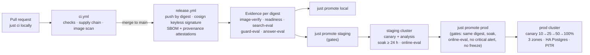

# From laptop to production: promoting the platform

> **IN PLAIN ENGLISH**
> On your Mac, the platform runs everything itself. In production the *same* application, built once
> into a signed container image, runs on real Kubernetes clusters next to managed or operator-run
> databases, a real identity provider and a secrets manager. A release never jumps straight to users:
> it is built and signed by CI, proves itself with evidence (tests, evaluations, readiness), runs in a
> staging environment shaped exactly like production for at least a day, then reaches production
> gradually as a *canary* that is compared with the current release and pulled back automatically if
> it is worse. Every move is a one-line change in git, reviewed in a pull request, and undone with
> `git revert`. This guide walks that path end to end and lists what you must fill in before the
> first real production release.

Background: [Step 27](../steps/step-27-ci-pipeline-and-supply-chain.md) (CI and supply chain),
[Step 28](../steps/step-28-vault-dynamic-secrets.md) (OpenBao),
[Step 29](../steps/step-29-kubernetes-gitops-argo-cd.md) (Kubernetes and GitOps),
[Step 36](../steps/step-36-lifecycle-threat-model-compliance.md) (lifecycle, backups, risk register),
[Step 37](../steps/step-37-production-environments-canaries-ha-dr.md) (environments, canaries, HA/DR),
[ADR-0027](../adr/0027-run-ci-with-pinned-tools-and-publish-signed-attested-images.md),
[ADR-0029](../adr/0029-run-rag-api-on-kubernetes-deployed-by-argo-cd-from-git.md),
[ADR-0037](../adr/0037-production-environments-canaries-and-recovery.md).
Start with [local-setup.md](local-setup.md) if the platform isn't running locally yet.

Contents: [1 · The path](#1-the-path-at-a-glance) · [2 · Environments](#2-three-environments-one-shape) ·
[3 · What changes per environment](#3-what-changes-between-laptop-and-production) ·
[4 · Build: CI and signed images](#4-build-ci-signed-and-attested-images) ·
[5 · Deploy: GitOps](#5-deploy-gitops-with-argo-cd) · [6 · Gates](#6-promotion-gates) ·
[7 · Canary and rollback](#7-canary-releases-and-rollback) · [8 · HA and DR](#8-high-availability-and-disaster-recovery) ·
[9 · Online evaluation](#9-online-evaluation-and-feedback) · [10 · Break glass](#10-break-glass) ·
[11 · Pre-production checklist](#11-pre-production-checklist) · [12 · Day-2 operations](#12-day-2-operations)

---

## 1. The path at a glance



Three rules hold everywhere:

1. **One artefact.** An image is built once, on `main`, and identified by its **digest** (`sha256:…`);
   that exact digest moves between environments. Nothing is rebuilt per environment.
2. **Git is the truth.** Each environment's overlay names the digest in one line
   (`deploy/envs/<env>/kustomization.yaml`). Argo CD makes the cluster match git. Rollback is
   `git revert` of the promotion commit.
3. **Evidence before movement.** [`deploy/envs/promotion.yaml`](../../deploy/envs/promotion.yaml) says
   what must be true; [`scripts/gates.py`](../../scripts/gates.py) checks it inside `just promote`.

---

## 2. Three environments, one shape

| | local | staging | prod |
|---|---|---|---|
| Where | OrbStack on your Mac | its own cluster | its own cluster, 3 zones |
| Overlay | [`deploy/envs/local`](../../deploy/envs/local/) | [`deploy/envs/staging`](../../deploy/envs/staging/) | [`deploy/envs/prod`](../../deploy/envs/prod/) |
| Dependencies | Compose services via [`components/external-deps`](../../deploy/components/external-deps/) | real services via [`components/managed-deps`](../../deploy/components/managed-deps/) | same as staging |
| Release style | plain Deployment | [`components/production`](../../deploy/components/production/): canary Rollout, analysis, HPA, zone spreading | same component |
| Replicas (HPA) | 2 | min 2, max 4 | min 3 (one per zone), max 12 |
| Prompt label | `production` (Compose) | `staging` | `production` |
| `rag.yaml` profile | `local` | `production` | `production` |
| Canary "not enough data" | n/a | `on-insufficient: pass` | `on-insufficient: fail` (fail safe) |
| Database | `rag-db` in Compose | CloudNativePG: 2 instances, `dataDurability: preferred`, backups 7 days ([`deploy/data/envs/staging`](../../deploy/data/envs/staging/)) | CloudNativePG: 3 instances across zones, quorum synchronous commit, `dataDurability: required`, 30-day PITR ([`deploy/data/base`](../../deploy/data/base/)) |
| Gates to enter | none (anything signed) | evidence ≤ 14 days old | same digest in staging, 24 h soak, evidence + online-eval, no critical alert, no freeze |
| Argo CD | [`deploy/argocd/apps`](../../deploy/argocd/apps/) | [`deploy/argocd/envs/staging`](../../deploy/argocd/envs/staging/) | [`deploy/argocd/envs/prod`](../../deploy/argocd/envs/prod/) |

> **WHY THIS MATTERS · ENVIRONMENT PARITY**
> Staging is smaller but has the same *shape* as prod: same base, same production component, same
> profile, same guards. Only names, sizes and addresses differ. "It worked in staging" then means
> something. A staging with one replica, no canary and no guards proves nothing.

Render any environment exactly as Argo CD would apply it: `just k8s-render envs/prod`; compare with a
running cluster read-only: `just k8s-diff envs/staging` (with the right kube context).

---

## 3. What changes between laptop and production

### Services: the cloud mapping

Every self-run piece has a managed equivalent with the same interface. Swapping one in changes **where
a name points** (an `ExternalName` in
[`deploy/components/managed-deps/services.yaml`](../../deploy/components/managed-deps/services.yaml)),
not rag-api's settings. The full table is [docs/architecture/cloud-mapping.md](../architecture/cloud-mapping.md); in short:

| Local | Production options |
|---|---|
| OrbStack Kubernetes | EKS / GKE / AKS or any conformant cluster (1.33+ for native sidecars) |
| Postgres + pgvector in Compose | CloudNativePG (this repo's default, `deploy/data`) or RDS/Aurora, Cloud SQL/AlloyDB, Azure Flexible Server |
| Qdrant · OpenSearch | Qdrant Cloud / Helm · Amazon OpenSearch, OpenSearch operator (Azure AI Search needs its own adapter) |
| SeaweedFS | S3 with Object Lock, GCS bucket lock, immutable Blob storage |
| Valkey | ElastiCache / Memorystore for Valkey, Azure Cache |
| Keycloak | Your company IdP (only issuer, audience and group claims matter) |
| OpenBao in Compose | OpenBao Helm chart, or the cloud's secret manager + workload identity |
| mlx-lm / TEI on the Mac | vLLM or TGI on GPU nodes, or Bedrock / Vertex AI / Azure OpenAI behind the same LiteLLM gateway |
| Prometheus/Grafana, Tempo/Loki | kube-prometheus-stack, Grafana Tempo/Loki, or managed equivalents (no question or answer text in logs) |
| Langfuse | Langfuse Helm chart (self-run: it holds prompts and answers) |

> **WATCH OUT**
> Changing the embedding model is a re-index (`rag reindex`, Step 36), not a config tweak. Data
> residency applies to backups too: a cross-region copy needs the same legal basis as the original.

### Names that rag-api uses, and where they point in prod

| Name | Points at (replace the examples) |
|---|---|
| `rag-db` | `rag-db-rw.rag-data.svc.cluster.local` (CloudNativePG's read-write service) or a managed Postgres |
| `litellm` | `litellm.ai-gateway.svc.cluster.local`: the gateway the platform team runs for every AI app |
| `opa` | `opa.policy.svc.cluster.local` |
| `openbao` | `openbao.openbao.svc.cluster.local` |
| `keycloak` | `sso.example.com`: your identity provider |
| `otel-collector` | `otel-collector.observability.svc.cluster.local` |

### Secrets and identity

| Concern | Local | Staging / prod |
|---|---|---|
| Bootstrap secrets | SOPS + age file on your Mac | The platform team's OpenBao (or cloud secret manager); nothing in git but references |
| Database logins | OpenBao dynamic users via the agent sidecar (1 h leases) | Same, through the pods' Kubernetes service account (`auth/kubernetes-jwt`) |
| Per-workload identity | rag-api and the worker share rag-api's identity in Compose | `rag-api` and `rag-ingest` each have their own service account, OpenBao role and policy ([`rag-ingest.hcl`](../../infra/config/openbao/policies/rag-ingest.hcl)); neither can read the other's secrets |
| Secrets in config | Never: `rag.yaml` only names files (`*_file`) | `rag config readiness` **fails** a profile that contains a secret value or a password in a URL |
| People | Keycloak realm `rag`, demo users | Your IdP; the issuer and JWKS URL are patched per environment (`RAG_API_OIDC_ISSUER`, `RAG_API_OIDC_JWKS_URL`) |
| Object storage credentials (backups) | n/a | The cloud's workload identity (`inheritFromIAMRole` in [`objectstore.yaml`](../../deploy/data/base/objectstore.yaml)) |

After any change to policies or roles: `just vault-setup`; after a cluster reset: `just vault-k8s-trust`.
The worker's secrets go in once with `just vault-put rag-ingest …` (see [Step 37 §7](../steps/step-37-production-environments-canaries-ha-dr.md#7--the-workers-own-identity-scheduled-jobs-and-legal-holds)).

### Configuration: the `production` profile

[`rag.yaml`](../../rag.yaml)'s `production` profile extends `local` with `uncited: abstain` (an answer
that cites nothing is not shown) and `stream: checked` (nothing unchecked is streamed to the person),
plus the full guard list. Check it any time:

```bash
uv run rag config readiness --profile production    # profile 'production': 0 error(s), 0 warning(s)
```

Readiness refuses in-memory stores, test stand-in models (`scripted`, `hashing`), a missing PII
component, missing required guards (`injection`, `context-injection`, `secrets`, `groundedness`),
`uncited: keep`, and inline secrets; it warns about `extractive` generation, an in-process cache, the
`term-overlap` reranker and `stream: live`.

---

## 4. Build: CI, signed and attested images

Workflows live in [`.github/workflows/`](../../.github/workflows/); every action is pinned to a commit
SHA and every tool binary to a SHA-256 ([`ci/tools.yaml`](../../ci/tools.yaml)).

| Workflow | When | What |
|---|---|---|
| [`ci.yml`](../../.github/workflows/ci.yml) | Every PR and `main` | `checks` (`just ci-static`, `ci-test` with a Postgres service, `ci-config`, `policy-check`), `supply-chain` (gitleaks on full history, actionlint, zizmor, pip-audit on `uv.lock`, licence policy, Trivy on the Dockerfile and the Kubernetes manifests), `image` (Buildx build, Trivy image scan failing on fixable HIGH/CRITICAL, Syft SBOM) |
| [`release.yml`](../../.github/workflows/release.yml) | Merge to `main` | Push `ghcr.io/<owner>/<repo>/rag-api` **by digest**, sign it keylessly with cosign (Sigstore), attach SBOM and SLSA provenance attestations; the run summary prints the digest |
| [`evals.yml`](../../.github/workflows/evals.yml) | PRs touching prompts, evals, the harness, search or policies; manual | Live evaluations on a **self-hosted Mac runner** with the models, behind the `evals` environment's approval |

Reproduce CI on your Mac: `just ci` (and `just image-scan` for the image job). After a merge:

```bash
gh run list --workflow release.yml --limit 1
just image-verify sha256:<digest>      # "signature OK" + provenance verified, before anything deploys it
```

### Recording evidence for the gates

The gates read small JSON files per digest and check, written by `just gates-record`:

```bash
just gates-record image-verify sha256:<digest> pass "cosign + attestation verified"
just gates-record readiness    sha256:<digest> pass "production: 0 errors"
just gates-record search-eval  sha256:<digest> pass "recall@5 0.96, 0 leaks"
just gates-record guard-eval   sha256:<digest> pass "catch 1.00, fp 0.00"
just gates-record answer-eval  sha256:<digest> pass "context_recall 1.00"
# prod only, from staging's online evaluation:
just gates-record online-eval  sha256:<digest> pass "candidate vs previous: pass"
```

Files land in `release-evidence/` as `<first 12 hex of the digest>-<check>.json`. **The workflows in this
repository don't yet call `gates-record`**: wire each check's result into the release pipeline (as a
build artefact the promoting person downloads into `release-evidence/`) before relying on the gates.

---

## 5. Deploy: GitOps with Argo CD

> **IN PLAIN ENGLISH**
> Nobody runs `kubectl apply` against production. Each cluster runs Argo CD, which watches this
> repository and makes the cluster match it. To deploy, you change git; to undo, you revert git.

Bootstrap a new staging or prod cluster ([Step 37 §9](../steps/step-37-production-environments-canaries-ha-dr.md#9--argo-cd-for-each-environment)):

1. Install Argo CD from the vendored, hash-checked manifest (as in Step 29): `kubectl kustomize
   deploy/argocd/install | kubectl apply --server-side -f -` against the new cluster's context.
2. Add the repository secret (a read-only deploy key), as `just k8s-repo-secret` does locally.
3. `kubectl apply -f deploy/argocd/envs/prod/root.yaml` (or `staging`). That's the only manual apply.
4. Argo CD then installs, in sync waves: the operators (Argo Rollouts, CloudNativePG; wave −1, cnpg
   with `prune: false`), the database tier `rag-data-<env>` (project `data`, wave 1, `prune: false` so
   removing it from git never deletes a database), then `rag-api-<env>` (project `rag`, wave 2).

CloudNativePG's Barman Cloud plugin needs **cert-manager** in the cluster. Database changes go through
the `data` project, which only allows the `rag-data` namespace and the CloudNativePG/Barman kinds
("Changes need a DBA review").

Upgrades of vendored components are pull requests too: `just argocd-vendor v3.x.y`,
`just vendor argo-rollouts|cnpg|barman-cloud <version>` (each records the new SHA-256), then `just k8s-check`.

---

## 6. Promotion gates

What must be true before a digest moves is a file, [`deploy/envs/promotion.yaml`](../../deploy/envs/promotion.yaml):

| Into | Rules |
|---|---|
| `local` | none: anything signed may run on your Mac |
| `staging` | evidence `image-verify`, `readiness`, `search-eval`, `guard-eval`, `answer-eval`, each passing, for this digest, at most 14 days old |
| `prod` | `from: staging` (the **same** digest runs in staging now), `soak_hours: 24` (measured from the git history of the staging overlay: when the merge deployed it; a rollback A → B → A restarts the clock), the same evidence **plus `online-eval`**, `alerts_clear: {severity: critical}` in staging, and no change freeze (`2026-12-21`–`2027-01-04`, "year-end change freeze") |

```bash
just gates staging sha256:<digest>                                          # may it go to staging?
just gates prod sha256:<digest> release-evidence http://alertmanager.staging:9093
just promote staging sha256:<digest>      # image-verify → gates → branch promote/staging-… → one-line commit → PR
just promote prod sha256:<digest>
```

`just gates` lists **every** failed rule, not just the first:

```text
BLOCKED: staging runs nothing, not this digest: promote to staging first
BLOCKED: evidence online-eval: missing (3f1c9a0b7e2d-online-eval.json)
BLOCKED: alerts can't be checked: pass --alertmanager URL
prod <- sha256:3f1c…9e0f: 3 gate(s) failed
```

The promotion PR still needs review (Code Owners) and green checks; merging it is the deploy.

---

## 7. Canary releases and rollback

```text
 10% canary ──15 min──▶ 25% ──15 min──▶ 50% ──30 min──▶ 100%: stable = new
       └──────── analysis all the way through ─────────▶ any check fails: canary scaled to 0,
                                                         stable keeps serving, RagCanaryAborted
```

[`deploy/components/production/analysis-template.yaml`](../../deploy/components/production/analysis-template.yaml)
compares the canary's `service_version` with the stable one's, every 2 minutes:

| Check | Passes when |
|---|---|
| `error-ratio` | ≤ 2% of the canary's answers in the last 10 min are errors |
| `latency-p95` | canary p95 ≤ 1.25 × stable p95 + 0.5 s |
| `blocked-vs-stable` | canary blocked share ≤ stable + 3 points |
| `abstained-vs-stable` | canary abstained share ≤ stable + 5 points |
| `audit-failures` | zero audit write failures (aborts on the first) |
| `online-eval` (a Job, after 45 min) | `rag online-eval --since-hours 2 --candidate <canary> --baseline <stable> --limit error_rate=0.02` exits 0 |

Most checks compare *canary minus stable*, so a provider outage that hurts both doesn't blame the canary.
Without a traffic router (service mesh or Gateway API plugin) the split follows pod counts.

**Rollback** ([canary runbook](../runbooks/canary.md), [kubernetes runbook](../runbooks/kubernetes.md)):

1. Automatic: a failed analysis scales the canary to zero; the stable release keeps serving.
2. Then revert the promotion commit through a PR (`git log --oneline -- deploy/envs/prod`, `git revert <commit>`).
3. Watch: `kubectl argo rollouts get rollout rag-api -n rag --watch`; which check failed:
   `kubectl -n rag describe analysisrun <name>`.
4. Emergency manual controls only: `kubectl argo rollouts abort rag-api -n rag`; finishing a verified
   hot fix early: `kubectl argo rollouts promote rag-api -n rag --full` (break glass, logged).

Prompt and model changes ride the same path: a prompt label change ([Step 24](../steps/step-24-prompt-registry.md))
or a model swap in the gateway is a reviewed change, evaluated, then visible per release in online evaluation.

---

## 8. High availability and disaster recovery

```text
 ZONE A                      ZONE B                       ZONE C                 backup bucket (other region,
 rag-api pods                rag-api pod                  rag-api pod            versioned + Object Lock)
 Postgres primary ──sync──▶  replica (synchronous)        replica (quorum)       WAL: continuous
                                    archive: WAL + nightly base backup ────────▶ base: 01:30 UTC, 30 days
```

| What failed | What happens by itself | What you do | Data lost (RPO) | Time (RTO) |
|---|---|---|---|---|
| A pod or node | Kubernetes replaces it | nothing | none | seconds |
| Postgres primary (pod, node, zone) | CloudNativePG promotes a synchronous replica, moves `rag-db-rw` | `kubectl cnpg status rag-db -n rag-data` | none | ~1 min |
| A whole zone | pods reschedule; Postgres fails over | watch capacity | none | minutes |
| Bad data (wrong delete, bad migration) | nothing: replicas copy the mistake | point-in-time restore into a **new** cluster, check, switch | to the second before | 1–2 h per 100 GB |
| The region or cluster | nothing | new cluster, Argo CD `root.yaml`, restore from the bucket | seconds–minutes | hours |
| Qdrant / OpenSearch | derived data | `rag reindex` | none | hours |
| Valkey | cache and memory are disposable | restart; re-enqueue if needed | conversations, cached answers | minutes |

Source: [disaster-recovery runbook](../runbooks/disaster-recovery.md).

**Drills.** Monthly, against prod's backups, restore to a given second into a new cluster, compare row
counts, record the restore time (your measured RTO) and delete it. It never restores over production:

```bash
uv run python scripts/dr_drill.py render "2026-10-13 08:59:00+00"   # review the manifest
just dr-drill "2026-10-13 08:59:00+00"
```

And for the logical backups (Step 36): `just db-backup` (dump + receipt) and `just db-restore-test <dump>`.

> **WATCH OUT**
> Replicas are not backups: they copy a mistake within milliseconds. Never restore *over* production
> in a panic. With `dataDurability: required`, writes wait when no replica can confirm them: ingestion
> pauses, searches continue. That trade is deliberate.

---

## 9. Online evaluation and feedback

> **IN PLAIN ENGLISH**
> Offline tests use labelled questions. Real users ask other things. Online evaluation reads the audit
> log (outcomes, citations, guard verdicts, and the release that answered) and people's thumbs up/down,
> and compares releases, with a statistics test so it doesn't cry wolf on noise.

- `rag online-eval` (`libs/rag-core/src/rag_core/online.py`): rates per release (abstained, blocked,
  cited, ungrounded, errors, thumbs down); a candidate fails a metric only if it is worse by more than
  the margin (0.02) **and** a one-sided two-proportion z-test says it's unlikely to be chance; fewer than
  50 answers → "insufficient". Exit codes: 0 pass, 1 fail, 3 not enough data.
- In the cluster: the canary's analysis Job, and the `rag-online-eval` CronJob every hour as `rag-ingest`
  (read-only audit access). On your Mac: `just online-eval --since-hours 6`.
- A **review queue** (`--queue review.jsonl`) lists answer ids with a thumbs down or a groundedness
  flag. Read ten, find the real problems, and add them as labelled questions to `examples/eval/*.yaml`,
  so CI catches them next time.
- Alerts on quality ([`rag-answers.yml`](../../infra/config/prometheus/rules/rag-answers.yml), unit-tested):
  `RagGuardBlocksSpike`, `RagAbstentionSpike`, `RagThumbsDownHigh`, `RagAnswerLatencyHigh`,
  `RagScheduledJobFailed`, `RagCanaryAborted` → [answer-quality runbook](../runbooks/answer-quality.md).

Try it without a cluster: `uv run python examples/online_demo.py` (a canary whose new prompt abstains
too often fails with z = 5.97).

---

## 10. Break glass

When a fix must reach production faster than the gates allow (a security fix during a freeze):

```bash
just promote prod sha256:<digest> "INC-1234: security fix for CVE-…"
```

The gates are skipped, the reason goes into the commit ("GATES SKIPPED (break glass): …") and the PR,
and the review still happens. Also break glass, also to be written in the incident log:
`kubectl argo rollouts promote rag-api -n rag --full`, an OpenBao root token from `bao operator
generate-root` (2 key shares), and `rag erase-source … --override-hold "reason"` for a document under a
legal hold.

---

## 11. Pre-production checklist

### Placeholders this repository still carries (fill them in)

| Item | Where | How |
|---|---|---|
| Model revision SHAs, sizes, licences, approver | [`infra/model-serving/models.yaml`](../../infra/model-serving/models.yaml) (`<40-char SHA…>`, `<you>`) | From `~/.cache/huggingface/hub/models--…/snapshots/` after download; confirm each licence on the upstream model page |
| Image digests marked `sha256:<digest>` | `deploy/argocd/install` (quay.io Argo CD v3.5.5), `deploy/argo-rollouts/install` (v1.10.1), `deploy/cnpg/install` (CloudNativePG 1.30.1, Barman plugin v0.15.1), `deploy/base/rag-api`, `deploy/base/rag-ingest`, `deploy/components/production` (quay.io OpenBao 2.7.1), `deploy/data/**` (Postgres 18 + pgvector images mirrored into your registry), `deploy/envs/*` (rag-api, set by `just promote`) | `docker buildx imagetools inspect <image:tag>`; mirror third-party images into your registry |
| Compose image digests taken from Docker Hub | [`infra/compose/compose.yaml`](../../infra/compose/compose.yaml) (several were resolved through Docker Hub or the `mirror.gcr.io` mirror because `quay.io` was unreachable when this repository was built, e.g. Keycloak, OpenBao, postgres-exporter) | Re-check each with `docker buildx imagetools inspect` against the publisher's own registry before relying on it |
| The Barman sidecar image named by tag | `deploy/cnpg/install/upstream/barman-cloud.yaml` (`plugin-barman-cloud-sidecar:v0.15.1`) | Mirror and pin it with the other images |
| GitHub owner `owner` | `deploy/cluster/policy-images.yaml`, `deploy/envs/*`, `deploy/argocd/**`, `deploy/data/**`, `repo_ssh` in the `justfile` | Your owner, lower case |
| Hostnames, storage, buckets, Prometheus | `sso.example.com`, `fast-ssd`, `s3://example-rag-db-backups/…`, `http://prometheus.monitoring.svc:9090` | Your IdP, SSD storage class (with volume expansion), backup bucket (other region, versioned, Object Lock), Prometheus address |
| Encrypted secrets files | `secrets/dev.enc.env`, `secrets/openbao-init.enc.json` (not in the repo by design) | `just secrets-init`, `just vault-init` on the right machine; production secrets live in the platform's OpenBao, never in this repo |
| Evaluation baselines | `evals/baselines/` (empty) | `just evals run …` against the real models, then `just evals baseline <run>` and commit with the reason |
| Evidence recording in CI | `.github/workflows/*` | Add `just gates-record` steps per check and keep `release-evidence/` as an artefact (section 4) |

### GitHub settings (not in files; set them in the UI)

- **Branch ruleset on `main`** (Settings → Rules → Rulesets): PR required with 1 approval and Code
  Owner review, stale approvals dismissed; required checks `lint, types, tests, policy, registries`,
  `secrets, workflows, dependencies, licences`, `build and scan the rag-api image`, up to date; signed
  commits; linear history; no force pushes or deletions.
- **Actions** (Settings → Actions → General): only GitHub, verified creators and the actions the
  workflows list; default `GITHUB_TOKEN` permission **read**; approval required for workflows from
  outside collaborators.
- **`evals` environment** with you (or the quality owner) as **required reviewer**.

> **WATCH OUT · THE SELF-HOSTED `rag-models` RUNNER ON A PUBLIC REPOSITORY**
> `evals.yml` runs on `[self-hosted, macOS, ARM64, rag-models]`: your Mac, with your models and
> whatever else is on it. It has a fork guard and an approval environment, but GitHub's own advice is
> **not to attach self-hosted runners to public repositories at all**, and this repository is public.
> Do one of these before registering the runner:
> 1. **Make the repository private** (recommended if the evaluations on your Mac matter to you), or
> 2. **Remove `.github/workflows/evals.yml`** and run the live evaluations by hand (`just evals run …`,
>    `just evals gate …`) on the Mac, recording the result with `just gates-record`.
>
> Never register the runner while the repository is public.

### Readiness review (the people part)

The automatable rules are checked by `just doctor` (MUST/SHOULD in
[rag-standards.md](../standards/rag-standards.md)). The *reviewed* rules need people and evidence:

- [ ] `rag config readiness --profile production` → 0 errors; `just doctor` → 0 MUST failed
- [ ] `just k8s-check`, `just alerts-test`, `just audit-test`, `just ci` pass
- [ ] SEC: auth, policy and audit on every path; access in every store (conformance); tenant RLS; PII
      redaction and erasure tested; workload identities; signed, pinned images (`just image-verify`)
- [ ] OPS: gated promotion and canaries exercised in **real** staging (a canary rolled out, a
      deliberately bad release aborted); SLOs and runbooks reviewed; `just dr-drill` restored and timed
- [ ] GOV: system card ([`cards/systems/rag-api.yaml`](../../cards/systems/rag-api.yaml)) current; risk
      register reviewed ([`risk-register.yaml`](../compliance/risk-register.yaml)); retention rules and
      legal holds agreed with legal; ADRs up to date
- [ ] Model cards: licences verified, evaluation results recorded (`just evals record … --card model:…`)
- [ ] Gateway keys per environment with budgets and expiry ([gateway access policy](../security/gateway-access-policy.md))
- [ ] Langfuse retention scheduled; audit anchor/verify scheduled; cards weekly lint scheduled
- [ ] On-call knows the [runbooks](../runbooks/) and the break-glass procedure

> **NOT EXERCISED YET**
> The manifests are validated by a real Kubernetes API server with the operators' schemas, but no
> Argo Rollouts or CloudNativePG controller has run against them here: the canary flow, failover,
> backups and the DR drill must be exercised in your staging cluster before you rely on them
> ([Step 37 notes](../steps/step-37-production-environments-canaries-ha-dr.md#notes-for-this-repository)).

---

## 12. Day-2 operations

| Rhythm | Task | Command / where |
|---|---|---|
| Every release | Promote local → staging → prod through the gates | `just promote <env> sha256:…` |
| Hourly | Online evaluation (CronJob `rag-online-eval`), audit anchor | `rag online-eval …`, `just audit-anchor` |
| Nightly | Retention with legal holds (CronJob `rag-retention`, 02:17 UTC), base backup (01:30 UTC), Langfuse retention | `deploy/base/rag-ingest/cronjobs.yaml`, `deploy/data/base/scheduled-backup.yaml`, `just langfuse-retention` |
| Daily | Audit chain verification | `just audit-verify` |
| Weekly | Read the review queue; cards lint strict; Dependabot PRs | `--queue review.jsonl`, `just cards lint --strict` |
| Monthly | DR drill; restore test | `just dr-drill "<time>"`, `just db-restore-test <dump>` |
| On change of embedder | Blue/green re-index, compare, switch by PR | `rag reindex --profile … --to … --apply`, `rag eval-search …` |
| On access change at a source | Update access everywhere at once | `rag reacl <uri> --group … --classification …` |
| On an erasure request | Erase the source or the subject (dry run first) | `rag erase-source …`, `rag erase-subject …` |
| On an alert | Follow its runbook | [docs/runbooks/](../runbooks/) |
| On a leaked secret | Rotate, revoke, record | [secret-leak runbook](../runbooks/secret-leak.md) |

More on monitoring, security and governance: [quality-and-operations.md](quality-and-operations.md).
