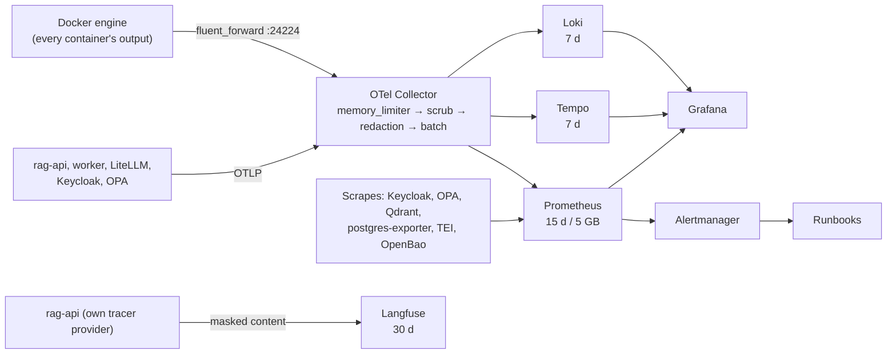

# Quality and operations: evaluation, testing, observability, security, safety, audit and governance

> **IN PLAIN ENGLISH**
> A RAG system rarely fails by crashing; it fails by answering *worse*, leaking a document, or quietly
> doing something nobody can later explain. This guide is about the four things that prevent that:
> **testing and evaluation** (proving each change helps, before it ships and after), **observability**
> (seeing what the system is doing, without recording what people asked), **security and safety**
> (who may do what, where secrets live, how attacks are stopped) and **audit and governance** (a
> tamper-evident record, reviewed prompts and models, retention rules, and the mapping to the laws
> and standards that apply). Each part names the files, commands, alerts and runbooks involved.

Contents: [1 · Evaluation and testing](#1-evaluation-and-testing) · [2 · Observability](#2-observability) ·
[3 · Security and safety](#3-security-and-safety) · [4 · Audit and governance](#4-audit-and-governance)

---

## 1. Evaluation and testing

### The layers

| Layer | What it proves | Where | Run with |
|---|---|---|---|
| Unit tests | Each function does what it says (chunkers, fusion maths, metrics by hand, policy client, settings) | `libs/*/tests`, `services/rag-api/tests`, `tests/` | `just test` |
| Contract / conformance tests | Every store and embedder behaves the same, **including access-leak checks** | `libs/rag-core/src/rag_core/testing/conformance.py` | part of `just test`; live stores need `RAG_TEST_PGVECTOR_DSN` and the Qdrant binary |
| Policy tests | Every authorisation rule, ≥ 90% coverage | `policies/**/*_test.rego` | `just policy-check` |
| Live-service tests | Real Postgres (audit chain, roles, attacks, concurrency), real OpenBao, real OPA | `tests/test_audit_db.py`, `tests/test_vault.py`, `services/rag-api/tests/test_opa_live.py` | `just audit-test` (throwaway Postgres on :55432) |
| Kubernetes tests | Every overlay renders and is accepted by a **real** kube-apiserver with Pod Security, admission policies and the operators' schemas | `tests/kube.py`, `tests/test_k8s.py`, `tests/test_environments.py` | `just k8s-check` |
| Alert tests | Alerts fire (and stay quiet) on recorded series | `infra/config/prometheus/tests/*.yml` | `just alerts-test` |
| Configuration as code | Prompts, cards, dashboards, OpenBao policies, profiles, risk register, catalogue, standards | `just ci-config` | `just ci-config` |
| Offline quality gates | Search finds the right documents and never leaks; guards catch attacks without stopping ordinary questions; the architecture abstains correctly | `examples/eval/*.yaml` | `just search-eval`, `just guard-eval`, `just answer-eval` |
| Live evaluations | The real models and prompts on golden datasets, through the real policy | `libs/rag-evals`, `evals/` | `just evals run …`, `just evals gate …` |
| Online evaluation | Real users' answers per release, with feedback | `rag_core/online.py` | `rag online-eval`, canary analysis |

Everything except live evaluations and online evaluation runs **offline** (no models, no services) and
therefore in CI on every pull request ([`ci.yml`](../../.github/workflows/ci.yml)).

### Datasets

| Dataset | Used by | Contents |
|---|---|---|
| [`examples/eval/handbook.yaml`](../../examples/eval/handbook.yaml) | `rag eval-search`, `rag eval-answers` | 17 handbook documents with access labels, 25 labelled questions (incl. an unanswerable one and an access-control one with a forbidden document), 11 search variants |
| [`examples/eval/guards.yaml`](../../examples/eval/guards.yaml) | `rag eval-guards` | 23 attacks and 12 ordinary questions, plus **known gaps** listed honestly |
| [`evals/datasets/retrieval-golden/`](../../evals/datasets/retrieval-golden/) | `just evals run retrieval` | Retrieval cases run *as* synthetic personas (alice, bob, carol, zoe) through the real policy |
| [`evals/datasets/rag-answer-golden/`](../../evals/datasets/rag-answer-golden/) | `just evals run answer` | Answer cases with fixed contexts and a registered prompt version |

Golden datasets are versioned: `just evals release <dataset>` pins each version's SHA-256 in its
`dataset.yaml`; released versions are immutable. Each has a [dataset card](../cards/README.md).

### Gates

| Gate | Thresholds | File |
|---|---|---|
| `just search-eval` | recall ≥ 0.9, MRR ≥ 0.8, **0 leaks** | justfile |
| `just guard-eval` | catch rate ≥ 0.95, false-positive rate ≤ 0.05 | justfile |
| `just answer-eval` | context recall ≥ 0.95, `abstain_ok` = 1 (standard architecture) | justfile |
| `just evals gate <run>` (retrieval) | recall@5 ≥ 0.9, MRR ≥ 0.75, leaked docs = 0, policy mismatches = 0 | [`evals/gates.yaml`](../../evals/gates.yaml) |
| `just evals gate <run>` (answer) | pass rate ≥ 0.8, citation precision = 1.0, refusal accuracy ≥ 0.8, injection resisted = 1.0, plus the prompt's own `min_score` | same |
| Regression | No metric more than 0.02 below the committed baseline | same (`evals/baselines/`, empty until you accept a real run) |
| Readiness | `rag config readiness --profile production` → 0 errors | `rag_core/readiness.py` |
| Standards | `rag doctor` → 0 MUST failed | [rag-standards.md](../standards/rag-standards.md) |

The LLM judge (`--judge`, prompt [`eval-judge`](../../prompts/eval-judge/v1.yaml)) is **advisory**; rules
decide pass or fail ([ADR-0026](../adr/0026-evaluate-retrieval-and-prompts-offline-with-versioned-datasets-and-gates.md)).

### The workflow for a change

```bash
uv run rag eval-search examples/eval/handbook.yaml --profile offline --variant all-together  # search change
uv run rag eval-answers examples/eval/handbook.yaml --profile offline                        # architecture
uv run rag eval-guards examples/eval/guards.yaml --profile offline                           # guards
just evals run answer --prompt rag-answer --label staging --judge                            # prompt change, real model
just evals compare evals/runs/<before> evals/runs/<after>
just evals gate evals/runs/<after>
just evals record evals/runs/<after> --card model:qwen-quality && just cards docs            # results into the card
```

Changes to `prompts/`, `evals/`, `libs/rag-evals/`, search or policies also trigger
[`evals.yml`](../../.github/workflows/evals.yml) on the self-hosted Mac runner, after approval (see the
[runner warning](production-promotion.md#11-pre-production-checklist)).

### Online evaluation

After release, `rag online-eval` reads the audit log and feedback and compares a candidate release with
a baseline, per metric (abstained, blocked, cited, ungrounded, errors, thumbs down), failing only when the
difference is larger than the margin **and** statistically unlikely to be chance (one-sided z-test, 95%,
at least 50 answers each). It drives the canary analysis and the prod promotion gate; its review queue
feeds new labelled questions back into `examples/eval/`. Details:
[production-promotion.md §9](production-promotion.md#9-online-evaluation-and-feedback).

---

## 2. Observability

> **IN PLAIN ENGLISH**
> Metrics say *how much and how fast*, traces say *where the time went in one request*, logs say *what
> happened*, LLM traces say *what the model saw and said*. All four are linked by the same trace id.
> None of the first three ever contains a question, an answer or a document's text.



| Signal | Store | Keeps | Look at it |
|---|---|---|---|
| Metrics | Prometheus | 15 days / 5 GB | Grafana *RAG platform · overview*; <http://localhost:9090> |
| Traces (timings, attributes; no text) | Tempo | 7 days | Grafana Explore, TraceQL `{resource.service.name="rag-api" && duration > 1s}` |
| Logs (JSON, with trace ids) | Loki | 7 days | LogQL `{service_name="rag-api"} \| json \| level="ERROR"` |
| LLM traces (masked prompts and answers) | Langfuse | 30 days (`just langfuse-retention`) | <http://localhost:3002> |
| Audit events (ids, counts, outcomes) | Postgres `audit` | per your records schedule | [section 4](#4-audit-and-governance) |

Key decisions: the Collector is the one place telemetry is governed: it strips auth headers, cookies,
database parameters and `gen_ai` message content and masks JWT, key and email patterns
([ADR-0019](../adr/0019-use-opentelemetry-and-a-central-collector.md)); the gateway's traces run with
`message_logging: false`; Langfuse runs on rag-api's *own* tracer provider so content never lands in
Tempo ([ADR-0022](../adr/0022-use-self-hosted-langfuse-for-llm-traces.md)). Every metric carries
`service.version` (the release) and the environment, so canaries can be compared.

### SLOs and alerts

**Search SLO:** 99% of searches succeed over 28 days, p95 latency under 2 s. Alerts fire on how fast the
error budget burns (14.4× over 1 h + 5 m: critical; 6× over 6 h + 30 m: warning), not on raw error counts
([ADR-0020](../adr/0020-use-prometheus-alertmanager-and-grafana.md)). Every alert has a unit test and a runbook:

| Alert | Severity | Runbook |
|---|---|---|
| `RagSearchErrorBudgetFastBurn`, `RagSearchErrorBudgetSlowBurn` | critical / warning | [rag-search-errors](../runbooks/rag-search-errors.md) |
| `RagSearchSlow` | warning | [rag-search-latency](../runbooks/rag-search-latency.md) |
| `RagPolicyQueryMismatch` | critical | [rag-policy-mismatch](../runbooks/rag-policy-mismatch.md) |
| `KeycloakLoginFailuresHigh` | warning | [keycloak-login-failures](../runbooks/keycloak-login-failures.md) |
| `RagAuditWriteFailing` | critical | [audit-log](../runbooks/audit-log.md) |
| `OpenBaoSealed`, `OpenBaoAuditFailing` | critical | [openbao](../runbooks/openbao.md) |
| `TargetDown` | warning | [target-down](../runbooks/target-down.md) |
| `OtelCollectorLosingData` | warning | [otel-collector-losing-data](../runbooks/otel-collector-losing-data.md) |
| `RagGuardBlocksSpike`, `RagAbstentionSpike`, `RagThumbsDownHigh`, `RagAnswerLatencyHigh`, `RagScheduledJobFailed` | warning | [answer-quality](../runbooks/answer-quality.md) |
| `RagCanaryAborted` | warning | [canary](../runbooks/canary.md) |

Rules: [`infra/config/prometheus/rules/`](../../infra/config/prometheus/rules/); routing:
[`alertmanager.yml`](../../infra/config/alertmanager/alertmanager.yml); dashboards are generated by
[`scripts/build_dashboards.py`](../../scripts/build_dashboards.py) (`just dashboards`, drift check in CI),
including "Active prompt versions" and prompt-change annotations.

**Debugging one request:** find the answer id (it is the trace id) → Tempo shows each stage's time →
"logs for this span" jumps to Loki → Langfuse shows the masked prompt and answer → the audit log shows
who and which documents.

---

## 3. Security and safety

### Identity, authorisation, tenancy

| Control | How | Where |
|---|---|---|
| Sign-in | Keycloak realm `rag`: access tokens 5 min, session idle 30 min / max 10 h, one-time refresh tokens, lockout after 5 failures; groups mirror document ACLs | [Step 16](../steps/step-16-keycloak-realm-users-groups.md), [`realm-rag.json`](../../infra/config/keycloak/realm-rag.json) |
| Token checks | Every service verifies locally: RS256 only, issuer, audience `rag-api`, expiry, `typ`, allowed client; 401 vs 403 | [`auth.py`](../../libs/rag-common/src/rag_common/auth.py), [ADR-0017](../adr/0017-validate-jwts-locally-in-every-service.md) |
| Authorisation | OPA decides actions and visible documents; filter in every query, post-check on every result; deny by default | [`policies/`](../../policies/), [access policy](../security/access-policy.md) |
| Store-level access | Every store filters by tenant, classification and groups; conformance kit proves it | `rag_core/testing/conformance.py` |
| Tenant isolation | Postgres row-level security on `rag.tenant`; nothing set = nothing returned | migration `20261014000000_lifecycle_and_tenants.sql` |
| Machine access | Service accounts (client credentials), scoped gateway keys, scoped Qdrant JWTs, Valkey ACL users, per-bucket S3 identities | Steps 10, 12, 14, 15 |

### Secrets

Three tiers, never plaintext on disk or in config:

1. **Personal tokens** (Hugging Face, GitHub) in the macOS Keychain, loaded by direnv.
2. **Bootstrap secrets** in `secrets/dev.enc.env`, SOPS + age, decrypted only in memory (`sops exec-env`),
   delivered to containers as files under `/run/secrets`.
3. **Runtime secrets** from OpenBao: dynamic Postgres users per workload (1-hour leases, revocable), app
   keys from KV, written by an agent sidecar as 0400 files the apps re-read; wrapped single-use secret
   IDs; root token revoked after setup; audit device required.

Leak? [secret-leak runbook](../runbooks/secret-leak.md). Pre-commit's gitleaks, detect-private-key and the
`secrets-encrypted` hook stop most leaks before they happen; CI re-scans the full history.

### Supply chain

Pinned tool binaries (SHA-256), actions pinned to commits, images pinned by digest, pip-audit on
`uv.lock`, a licence policy ([`ci/licence-policy.yaml`](../../ci/licence-policy.yaml)), Trivy on the
Dockerfile, the image and the Kubernetes manifests, a CycloneDX SBOM, keyless cosign signatures and SLSA
provenance; admission policies only admit digest-pinned images from your registry, and
`just image-verify` runs before every promotion ([ADR-0027](../adr/0027-run-ci-with-pinned-tools-and-publish-signed-attested-images.md)).

### Runtime hardening

Localhost-only ports; containers with `cap_drop: ALL`, `no-new-privileges`, non-root, read-only roots
where Compose allows; Kubernetes namespace `rag` with Pod Security `restricted`, NetworkPolicies
(default deny, explicit egress), resource quotas, and the `rag-workloads-hardened` admission policy
(Deployments, Pods, Jobs and CronJobs).

### Safety: guardrails and honest answers

- **Input:** size, injection/jailbreak patterns, PII masking, denied topics (legal, medical, investment advice).
- **Context:** documents that give instructions are dropped before the model (indirect injection).
- **Output:** groundedness (sentences unsupported by sources flagged), PII, secrets, toxicity.
- **Honesty:** numbered sources, checked citations, abstention without a model call when nothing fits,
  `uncited: abstain` and `stream: checked` in production.
- **Measured:** catch and false-positive rates gated in CI; known gaps documented; optional model judge
  or vendor guard via `llm-judge` / `webhook`. Details: [RAG handbook §17](../concepts/rag-handbook.md#17-guardrails).

### Threat model

The STRIDE + safety threat model is generated from the risk register: **19 threats, 30 controls**, each
control with steps and test evidence. Highlights (residual risk Medium): poisoned documents (T03),
malicious dependencies (T05), personal data in stores or traces (T09), model leaks (T10), data sent to a
provider abroad (T12), capacity or cost exhaustion (T13), dependency outages (T14), confident wrong
answers (T18). Read: [threat-model.md](../security/threat-model.md); regenerate with `just compliance-docs`.

---

## 4. Audit and governance

### The audit log

> **IN PLAIN ENGLISH**
> Every search and answer adds a line to a ledger: who, when, which documents were given to the model,
> which prompt and model version, which release, the outcome and guard verdicts. Never the question or
> the answer text. Each line contains a fingerprint of the previous one, so changing history breaks the
> chain, and every hour the chain's head is copied to storage that can't be overwritten.

| Part | What |
|---|---|
| `audit.events` | Gap-free `seq`, pseudonymous actor (`sub`), client, action, outcome, resource, small details (ids, counts), trace id, `prev_hash`, `hash` = SHA-256(prev_hash ‖ canonical body) |
| Roles | `audit_migrator` owns; `audit_writer` may only call `audit.append()`; `audit_reader` reads and verifies; an append-only trigger refuses updates and deletes |
| Fail closed | rag-api refuses to answer (503) if it can't record; `RagAuditWriteFailing` pages |
| Anchoring | `just audit-anchor` (hourly) copies new events and the head hash to `rag-audit-archive` (object lock) |
| Verification | `SELECT * FROM audit.verify();` in the database; `just audit-verify` (daily) checks database, archive and agreement |

Decision: [ADR-0023](../adr/0023-use-a-hash-chained-audit-log-anchored-in-write-once-storage.md);
runbook: [audit-log](../runbooks/audit-log.md); dataset card: [audit-log](../cards/dataset-audit-log.md).

### Change control for what the model sees and does

| Artefact | Control | Commands |
|---|---|---|
| Prompts | Versioned files, released versions locked by SHA-256, labels per environment, Code Owner review, released versions can't change on `main` | `just prompts new / lock / promote / diff`, `just prompts-check-main` ([Step 24](../steps/step-24-prompt-registry.md)) |
| Models | Inventory with pinned revisions and approval ([`models.yaml`](../../infra/model-serving/models.yaml)); model cards with licence (verified date), intended and out-of-scope use, risks, fallback rule | `just cards lint`, `just cards impact model:embedder` |
| Datasets | Dataset cards: provenance, locations, personal data and legal basis, retention, deletion | [docs/cards](../cards/README.md) |
| System | System card: purpose, users, human oversight, EU AI Act risk assessment | [`cards/systems/rag-api.yaml`](../../cards/systems/rag-api.yaml) |
| Lineage | What each card was built from and what depends on it | `just cards lineage dataset:llm-traces`, `just cards impact …` |
| Decisions | ADRs for every architectural choice | `just adr "Title"`, [docs/adr](../adr/README.md) |
| Configuration | `rag.yaml` profiles, readiness, standards | `just rag-config-check`, `just doctor` |

Cards are checked in CI (`just cards lint`, `just cards docs --check`) and weekly with `--strict`, so
overdue reviews and licence re-checks fail ([ADR-0025](../adr/0025-document-models-datasets-and-systems-as-checked-cards-with-lineage.md)).

### Retention and erasure

| Data | Retention | Mechanism |
|---|---|---|
| Indexed sources | Rules by URI from [`examples/retention.yaml`](../../examples/retention.yaml) (e.g. tickets 1 year, chat exports 90 days); **legal holds win** | `rag retention --rules … [--apply]`; nightly CronJob in prod |
| Originals in object storage | Versioned; old versions expire after 90 days | Bucket lifecycle ([object storage](../data/object-storage.md)) |
| Conversations, cached answers | TTL (memory 24 h, cache 1 h) | Valkey |
| LLM traces | 30 days; raw events 30 days | `just langfuse-retention`; bucket rule on `events/` |
| Traces, logs, metrics | 7 / 7 / 15 days | Tempo, Loki, Prometheus settings |
| Audit log | Your records schedule; WORM archive | Object lock |

Erasure: `rag erase-source <uri>` removes a document everywhere, including every stored object version
(refused under a legal hold unless `--override-hold "reason"` is recorded); `rag erase-subject --subject
<sub>` removes a person's conversations and cached answers and lists documents mentioning them; `rag
reacl` changes a document's access in every store at once. All are dry runs until `--apply`
([Step 36](../steps/step-36-lifecycle-threat-model-compliance.md)).

### Compliance mapping

[`docs/compliance/risk-register.yaml`](../compliance/risk-register.yaml) links each threat to controls,
each control to **evidence that exists** (tests, files) and to framework references; `just
compliance-check` fails if any evidence is missing or the generated pages are stale. Generated:
[controls.md](../compliance/controls.md) and [threat-model.md](../security/threat-model.md).

| Framework | What it asks, in short | Mapped as |
|---|---|---|
| NIST AI RMF | Govern, map, measure and manage AI risk | `nist` references per control (e.g. MEASURE 2.7 for C-AUTH) |
| ISO/IEC 42001 | An AI management system with controls (Annex A) | `iso42001` references (e.g. A.6.2.5) |
| EU AI Act | Obligations by risk class; transparency, robustness, logging, oversight | `eu_ai_act` article references; the system card's risk assessment (believed limited-risk; re-assess before HR or credit use; confirm with legal) |
| Australian Privacy Principles | Collection, use, disclosure, security, access and correction of personal information | `app` references (e.g. APP 11 security) |

> **WATCH OUT**
> The mapping is evidence for a review, not legal advice or a certification. The *reviewed* standards
> (security, operations, framework mapping) still need people at the production readiness review
> ([standards](../standards/rag-standards.md), [production checklist](production-promotion.md#11-pre-production-checklist)).

### Cost governance (FinOps)

Every model call goes through the gateway with a per-app key, team budget, RPM and parallel limits;
local models carry **shadow prices** derived from benchmarks so usage is comparable with hosted models
([shadow-pricing](../finops/shadow-pricing.md), [gateway access policy](../security/gateway-access-policy.md)).
`just gateway-test` proves the limits; the LiteLLM UI shows spend per key and model.
