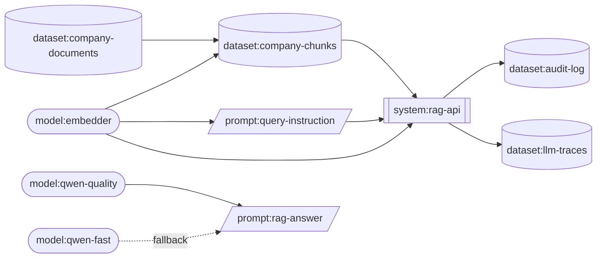

# Step 25 · Model, dataset and system cards, and lineage

*Step 25 of 38 · Phase F · Audit & governance*

## At a glance

| | |
|---|---|
| **Goal** | Write down, in short reviewed files, what every AI component is, where it came from, what it may and may not be used for, what personal data it holds, and what depends on it. Then let a tool check those answers against the platform's real configuration. |
| **How, in one sentence** | YAML cards in `cards/` (one per model, dataset and system) declare their owner, status, purpose, limits and inputs; a checker cross-checks them against `models.yaml`, the gateway config and the prompt registry, builds a lineage graph, answers "what's affected if this changes?", and publishes readable pages in `docs/cards/`. |
| **Time** | About 2 hours. |
| **You'll end up with** | 4 model cards (`qwen-quality`, `qwen-fast`, `embedder`, `reranker`), 5 dataset cards (source documents, derived indexes, LLM traces, the audit log, the planned evaluation set) and 1 system card (`rag-api`) · `rag_common.cards`: schemas, 21 rules, the lineage graph, impact analysis and Markdown pages · `just cards lint \| docs \| impact \| lineage`, a pre-commit hook and a weekly strict check for overdue reviews · 28 new tests in the guide's count (129 in total) · ADR-0025. |
| **New words** | model card, datasheet (dataset card), system card, provenance, lineage, upstream and downstream, impact analysis, single source of truth, card status, review interval, SPDX licence id, legal basis, pseudonymous data, DAG (directed acyclic graph), Mermaid, OpenLineage, ML-BOM. |

## The big idea

> **ANALOGY · THE LABELS IN A HOSPITAL PHARMACY**
> A hospital pharmacy doesn't keep bottles of "some white pills". Every medicine has a label and a leaflet:
> - what it is, and which batch it came from
> - what it's for, and what it must not be used for
> - its known side effects
> - how to store it, and when it expires
>
> And the pharmacy keeps a register: which batch went into which prescription for which ward. When a
> manufacturer recalls batch 42, the pharmacist can answer within minutes: who received it, and what must we
> check?
>
> Our platform has its own medicines: models and datasets. A **card** is the label and leaflet. The **lineage
> graph** is the register. And `just cards impact model:embedder` is the recall question: if this changes, what
> must we re-check?

There are three kinds of card, and each answers its own questions:

| Model card (`model:embedder`) | Dataset card (`dataset:company-documents`) | System card (`system:rag-api`) |
|---|---|---|
| What is it, and which exact weights? | Where does it come from? | What is it for, and for whom? |
| Licence: which, verified when? | Where does every copy live? | What must it never be used for? |
| Intended use / out of scope | Highest classification | Human oversight: who can stop it? |
| Known limits and risks | Personal data? Legal basis? | Risk assessment (EU AI Act) |
| Training data (as disclosed) | Retention and deletion | Built from which models, datasets and prompts? |
| Where do prompts go? | Who may access it? | Known limits |
| Evaluation results (Step 26) | Gaps and biases | |

Every card also has: an **owner**, a **status** (`planned → candidate → approved → deprecated → retired`),
recorded **approvals**, a **review date with an interval**, and its **inputs**, from which the lineage graph is
built.

*(Figure 79 in the guide: the three kinds of card and the questions each one answers.)*

## What we're doing

1. Define the card format for models, datasets and systems, plus a short policy (allowed licences, licence
   re-check interval).
2. Write the 10 cards for everything the platform already runs.
3. Cross-check the cards against the facts that live elsewhere: `models.yaml` (Steps 7–8), the gateway config
   (Steps 9–10) and the prompt registry (Step 24).
4. Build the lineage graph, and ask it questions: *what's downstream of this?*, *what is this built from?*
5. Publish readable pages in `docs/cards/`, generated and checked like the dashboards (Step 20).
6. Wire it into pre-commit, a weekly strict run, and record ADR-0025.

## Why we're doing this

> **WHY THIS MATTERS**
> Six months from now, someone will ask one of these questions. Without cards, each one takes days of
> digging; with them, minutes:
> - *"Can we use this model for screening job applicants?"* The model card's **out of scope** list says no,
>   and why.
> - *"The embedding model has a new release. What breaks if we upgrade?"* `just cards impact model:embedder`
>   lists every index, prompt, service and dataset, with owners.
> - *"An employee asks us to delete their data. Where is it?"* The dataset cards with `personal_data: true`
>   list every location, the retention and the deletion route.
> - *"Is our use of this model's licence OK?"* The card says which licence, and when someone last read it.
> - *"Is this an EU AI Act high-risk system?"* The system card records the assessment, and who made it.
>
> Cards also catch configuration mistakes automatically, because they're checked against the real platform.
> A model served without a card, a retired model still in the gateway, a fallback for the embedder: each
> fails the build.

| Need | How this step meets it |
|---|---|
| Know what each component is and may be used for | Model, dataset and system cards: intended use, out of scope, limits, risks |
| Know exactly which weights run | Card ↔ `models.yaml` cross-check: pinned 40-character revision required |
| Licence compliance | Allowed licence list; licence verified on a date; yearly re-check |
| Personal data accountability | Dataset cards: what personal data, legal basis, retention, deletion route, every location |
| "What breaks if X changes?" | Lineage graph from card inputs, prompt→model links and gateway fallbacks; `just cards impact` |
| No served model without review | Every gateway alias needs an approved (or candidate) card; fallback targets must be approved |
| Cards don't rot | Review intervals; overdue reviews warn, and fail the weekly strict run |
| Readable by non-engineers | Generated Markdown pages with a Mermaid lineage diagram |

> **IN A COMPANY**
> Cards come from research, and became expected practice:
> - *Model Cards for Model Reporting* (Mitchell et al., 2019) and *Datasheets for Datasets* (Gebru et al.,
>   2018) defined the idea. Hugging Face model cards, Google's Data Cards and the "system cards" published
>   with frontier models all descend from them.
> - Regulation and standards expect this documentation:
>   - The **EU AI Act** requires technical documentation for high-risk systems (Annex IV) and documentation
>     from general-purpose model providers. It also requires that people be told when they're interacting
>     with AI.
>   - **ISO/IEC 42001** (AI management systems) and the **NIST AI RMF** ("Map" function) require knowing
>     your AI components, their context and their risks.
> - **GDPR** requires a record of processing activities (Article 30) and a legal basis for each. Dataset
>   cards are the engineering side of that record. Note that pseudonymised data, like our `sub` ids, is still
>   personal data.
>
> In a company, cards are owned by the teams who know the answers. Data owners sign dataset cards, the
> platform team signs model cards, and product with legal signs system cards. A governance or risk team
> reads all three.

## Key ideas

| Term | Plain-English meaning |
|---|---|
| Model card | A short document about one model: what it is, where it came from, intended use, limits, evaluation, licence. |
| Datasheet / dataset card | The same for a dataset: provenance, contents, personal data, retention, access, gaps. |
| System card | The same for an application built from models and data: purpose, users, oversight, risk assessment. |
| Provenance | Where something came from, and how it was made. |
| Lineage | The chain of "built from" links between components. **Upstream**: what something depends on. **Downstream**: what depends on it. |
| Impact analysis | Following lineage downstream to find everything affected by a change. |
| Single source of truth | Each fact lives in exactly one file; other places check it rather than copy it. |
| Card status | `planned → candidate → approved → deprecated → retired`: where the component is in its life. |
| Review interval | How often a card must be re-read and re-confirmed (e.g. every 90 or 180 days). |
| SPDX licence id | The standard short name for a licence (`apache-2.0`, `mit`), so tools can compare them. |
| Legal basis | The GDPR reason that makes processing personal data lawful (contract, legal obligation, legitimate interest…). |
| DAG | Directed acyclic graph: arrows with no loops. Lineage must be one, or "what was this built from?" has no answer. |
| Mermaid | A text format for diagrams that GitHub and many wikis render automatically. |
| OpenLineage, ML-BOM | Standards for lineage events from pipelines (OpenLineage) and for listing models and datasets as a bill of materials (CycloneDX ML-BOM, SPDX 3 AI/Dataset profiles). |

### One fact, one home

The platform already records some facts about models, in three places. Cards don't copy them; they **check**
them:

| Where | What it holds |
|---|---|
| `infra/model-serving/models.yaml` (Steps 7–8) | repo, revision SHA, embedding contract |
| LiteLLM config (Steps 9–10) | the aliases served, and their fallbacks |
| Prompt registry (Step 24) | which model each prompt runs on |
| `cards/` (this step) | judgement: use, limits, data, owner |

`just cards lint` reads all four. Facts are checked, never copied.

- **Errors fail the build:** a served model without a card; a retired model still served; an embedder with a
  fallback; a prompt on an unapproved model; a licence not allowed or unverified; personal data with no legal
  basis; the query instruction ≠ the embedding contract.
- **Warnings fail the weekly run (with `--strict`):** a review overdue; a licence re-check due; no evaluation
  yet.

*(Figure 80 in the guide: where each fact lives. One fact, one home: `models.yaml` says WHICH weights; the
card says WHETHER and HOW to use them.)*

Copying facts creates two versions of the truth that drift apart. A card that said "revision abc123" while
`models.yaml` said "def456" would be worse than no card. So the generated page *shows* the revision, but takes
it from `models.yaml`.

### The lineage graph



*(Figure 81 in the guide: the platform's lineage, simplified. Changing the embedder affects the chunk indexes,
the query instruction, rag-api, and through rag-api the audit log and LLM traces. rag-answer runs on
qwen-quality and may fall back to qwen-fast.)*

Edges come from three places:
- **Card `inputs`**: "company-chunks is built from company-documents and the embedder".
- **The prompt registry**: "rag-answer runs on qwen-quality".
- **The gateway's fallbacks**: "…and may fall back to qwen-fast". A model change can reach a prompt that never
  names it.

## How to do it

On the Mac, in the project folder, on a feature branch:

```bash
cd ~/dev/rag-platform
git switch -c feat/cards-and-lineage
```

### 1 · The policy

`cards/policy.yaml` holds the rules every card is checked against. Changing it needs the platform owner's
review, like any policy:

```yaml
allowed_licences:              # SPDX ids. Anything else needs legal review first, then a line here.
  - apache-2.0
  - mit
  - bsd-3-clause
licence_review_days: 365       # re-read each model's licence at least yearly: terms can change
```

### 2 · Model cards

Four files in `cards/models/`: `embedder.yaml`, `qwen-quality.yaml`, `qwen-fast.yaml`, `reranker.yaml`. The
embedder's card, in full:

```yaml
kind: model
id: embedder
title: Qwen3-Embedding-0.6B (embedder)
status: approved
owner: rag-platform
task: embedding
summary: >-
  Turns text into 1024-number vectors for semantic search, served by TEI (Step 8). Every chunk in
  every index, and every query, goes through it, under the embedding contract in models.yaml.
licence:
  id: apache-2.0
  url: https://huggingface.co/Qwen/Qwen3-Embedding-0.6B
  verified_on: 2026-10-12
intended_use:
  - Embedding document chunks at indexing time
  - Embedding queries, prefixed with the registered query instruction (prompt query-instruction)
out_of_scope:
  - Comparing vectors from a different embedding model or contract (another vector space)
  - Classification or clustering decisions about people
risks:
  - Changing the model, revision or contract silently breaks search unless everything is re-indexed
training_data: >-
  Built on the Qwen3 foundation models and trained on large-scale text pairs, per the publisher;
  supports 100+ languages. Datasets not disclosed in detail.
data_handling: Runs on the Mac (TEI); text and vectors never leave the machine.
fallback_allowed: false            # another embedder = another vector space: never fall back
known_limitations:
  - Queries without the task instruction retrieve noticeably worse (publisher reports 1-5%)
  - Input beyond the chunk limit in the contract is truncated silently by the server
last_reviewed: 2026-10-12
review_every_days: 180
approvals:
  - {by: you, date: 2026-10-12, note: "Step 8: embedding contract recorded"}
```

> **READING A MODEL CARD**
> - **No repo or revision here**: they're in `models.yaml` (Steps 7–8). The checker requires a pinned
>   40-character revision there for every approved model.
> - `licence.verified_on`: the date a person actually read the licence on the upstream page. "Apache-2.0 per
>   the model list" is a guess; a date and a name is evidence. Fill in your own dates, from when you checked.
> - `out_of_scope` is the most important field for the future. Write down what this model must not be used
>   for, while you still remember why.
> - `fallback_allowed: false` turns the Step 8 rule (another embedder is another vector space) into a check
>   against the gateway config.
> - `evaluation` stays empty until Step 26 writes results into it. Until then, each approved model raises one
>   warning.

The other three follow the same shape:

- **qwen-quality** (Qwen3.8-27B, 8-bit MLX, generation): the careful, slower chat model for grounded answers,
  synthesis and drafting evaluation judgements. Out of scope: decisions about people without a human deciding;
  legal, medical or financial advice presented as authoritative; answering company questions without retrieved
  sources. Risks: hallucination, prompt injection through retrieved documents, a little accuracy lost to 8-bit
  quantisation. `fallback_allowed: true` (the gateway may send it to qwen-fast if its server is down).
- **qwen-fast** (Qwen3.6-35B-A3B, 4-bit MLX, a mixture of experts with ~3B parameters active): query
  rewriting, routing, classification and short answers. Out of scope: long multi-document synthesis where
  accuracy matters, decisions about people. Risks: weaker reasoning (so as a fallback, answers may be less
  accurate), more accuracy lost to 4-bit.
- **reranker** (bge-reranker-v2-m3, a multilingual cross-encoder on TEI): re-orders the top 20–100 candidates.
  Out of scope: filtering for permissions (only the policy, Step 18, decides who may read what) and treating
  scores as calibrated probabilities across queries. `fallback_allowed: false`: the app skips reranking
  instead (Step 10).

> **TWO YAML TRAPS THIS STEP FELL INTO**
> - **`on` means `true`.** YAML 1.1, which PyYAML follows, reads the bare words `on`, `off`, `yes` and `no` as
>   booleans. An approval written `{by: you, on: 2026-10-12}` became a mapping with the key `True`, and
>   validation failed. That's why the field is called `date`. A test now documents the trap. (It's the same
>   bug that famously turns the country code `NO` into `false`.)
> - **A colon followed by a space starts a mapping.** The list item `- Hallucination: fluent, confident…`
>   became `{"Hallucination": "fluent…"}`, not text. Rephrase, or quote the whole line.
>
> Strict schemas (`extra="forbid"`, typed fields) are what turn these silent surprises into clear errors.

### 3 · Dataset cards

Five files in `cards/datasets/`:

| Card | Role | Owner | Personal data | Retention |
|---|---|---|---|---|
| `company-documents` | source: the original files (s3://rag-raw-docs and `rag.documents`) | knowledge-management (the *data* owner) | yes: staff names, roles, contact details, some HR content | follows the source system; deleted files gone within 7 days (Step 36) |
| `company-chunks` | derived from company-documents + the embedder: `rag.chunks`, Qdrant `rag_chunks`, OpenSearch `rag-chunks` | rag-platform | yes, as text and as vectors | as long as the source document; rebuilt, never edited |
| `llm-traces` | operational, from rag-api: self-hosted Langfuse | rag-platform | yes: masked questions (names can remain), pseudonymous `sub` | 30 days (Step 22 retention job) |
| `audit-log` | operational, from rag-api: `audit.events` + s3://rag-audit-archive | security | yes: pseudonymous `sub`, actions, times, document ids | years (object lock); erasure by deleting the Keycloak identity |
| `rag-answer-golden` | evaluation, from company-documents: `evals/datasets/rag-answer-golden/` | rag-quality | **no** (a rule: evaluation sets never hold personal data) | in git as long as the prompts it evaluates |

> **READING A DATASET CARD**
> - `owner` is the **data owner** (here, knowledge management), not the platform team. They decide what goes
>   in and who may read it; the platform enforces it.
> - `locations` lists **every copy**. A deletion request has to reach all of them.
> - `personal_data: true` makes `personal_data_notes` and `legal_basis` mandatory. The legal basis here says
>   "to be confirmed in a DPIA" (data protection impact assessment). Writing down that it's unconfirmed is
>   honest, and visible.
> - `deletion` describes the **route**, not just the intention.

> **CARDS FOR THINGS THAT DON'T EXIST YET**
> `rag-answer-golden` is `planned`. It already appears in the lineage, and its rules apply from day one: an
> evaluation set may not contain personal data. Writing the card first is a cheap way to design the dataset
> before building it in Step 26.

### 4 · The system card

`cards/systems/rag-api.yaml` describes the platform's front door: it authenticates people (Step 17), asks the
policy what they may read (Step 18), searches, records who received what (Step 23), and, from Step 32,
answers. Its inputs are `dataset:company-chunks`, `model:embedder` and `prompt:query-instruction`. It records
the **purpose** (help employees find information in documents they may read), the **users** (employees via
Keycloak; machine clients with service accounts), **out of scope** (decisions about people; authoritative
legal, medical or financial advice; any route to documents the policy doesn't allow), **human oversight**
(results show their sources; prompts and models can be rolled back; the service can be switched off; every
access is audited) and the **risk assessment**: believed limited-risk under the EU AI Act, so users must be told
they are using AI; re-assess before any HR, credit or similar use.

> **THE RISK ASSESSMENT IS A DECISION, NOT A FIELD**
> The EU AI Act classifies **uses**, not models. The same rag-api used to search handbooks and used to screen
> job applicants falls into different categories, with very different obligations. The system card records
> your assessment and its assumptions, so that a change of use triggers a new one. Have your legal or
> compliance team confirm it. This guide is not legal advice.

### 5 · The library: schemas, rules, lineage, pages

`libs/rag-common/src/rag_common/cards.py` holds everything:

- **Schemas**: one pydantic model per kind (`ModelCard`, `DatasetCard`, `SystemCard`, sharing `Card`), all
  with `extra="forbid"` and `frozen=True`. Required lists (`known_limitations`, `intended_use`,
  `out_of_scope`) must have at least one entry. "We'll fill it in later" doesn't validate. The file name must
  equal the card's `id`.
- **`edges()`** builds the graph from three sources: card inputs, prompt-to-model links from the registry
  (across *all* versions, since staging may run a different model), and gateway fallbacks.
- **`downstream()`** walks breadth-first, so the impact list shows distance: direct dependents first, then
  theirs. **`upstream()`** collects everything a node was built from.
- **The rules (`check`)**, grouped:
  - *Every card*: inputs exist and are well-formed; approved means a recorded approval; reviews aren't
    overdue; nothing approved depends on something deprecated.
  - *Models*: licence allowed and verified, re-checked yearly; a pinned revision in `models.yaml`; no gateway
    fallback when `fallback_allowed` is false; evaluation results (a warning until Step 26).
  - *Datasets*: personal data needs notes and a legal basis; a derived dataset names its sources; evaluation
    sets hold no personal data.
  - *Across files*: every gateway alias and every `models.yaml` entry has a card; nothing retired is served;
    fallback targets are approved; every label of every prompt runs on an approved model; the query
    instruction equals the embedder's contract (the warning from Step 24, now enforced); the graph has no
    cycles.
- **Errors vs warnings**: errors are wrong *now* (a served model without a card). Warnings become wrong *with
  time* (a review overdue). Failing every pull request because a date passed would punish whoever happens to
  open the next PR. So warnings fail only the weekly strict run, which goes to the owners.
- **`render_markdown`** produces the human page, with the generated-file marker, the weights and revision
  taken from `models.yaml`, and the lineage in both directions. `render_index` produces the table of all cards
  plus the Mermaid diagram.

### 6 · The command line

`scripts/cards.py`, run through the new `just` recipe:

```text
just cards lint [--strict]          every rule; --strict turns warnings into failures (weekly CI)
just cards docs [--check]           write docs/cards/*.md from the YAML (--check: fail if stale)
just cards impact model:embedder    what is affected if this changes
just cards lineage system:rag-api   what this was built from
```

The `justfile` gains:

```make
# ---- Cards and lineage (Step 25) ----
[positional-arguments]
cards *args:
    uv run python scripts/cards.py "$@"
```

`.pre-commit-config.yaml` gains a local hook that runs whenever a card, a prompt, the inventory or the
gateway config changes, so a gateway change that breaks a rule is caught as surely as a card change:

```yaml
      - id: cards
        name: cards (rules, cross-checks, generated docs up to date)
        entry: bash -c 'uv run python scripts/cards.py lint && uv run python scripts/cards.py docs --check'
        language: system
        files: ^(cards/|prompts/|docs/cards/|infra/model-serving/models\.yaml|infra/config/litellm/)
        pass_filenames: false
```

`.github/CODEOWNERS` gains `/cards/models/`, `/cards/datasets/`, `/cards/systems/` and `/cards/policy.yaml`
(in a company: models → platform team, datasets → each data owner, systems → product + legal, policy →
platform owner). And the weekly strict run goes into your crontab (`crontab -e`), until CI does it in Step 27:

```text
0 8 * * 1   cd ~/dev/rag-platform && just cards lint --strict >> ~/Library/Logs/cards-weekly.log 2>&1
```

### 7 · Publish the pages

```bash
just cards docs            # writes docs/cards/*.md: commit them with the cards
just cards docs --check    # fails if a card changed but its page wasn't regenerated
```

Each card gets a page (`docs/cards/model-embedder.md`, `dataset-company-documents.md`, …) with a facts table
(id, status, owner, last review, and for models the task, weights from `models.yaml`, licence and fallback
rule), then summary, intended use, out of scope, training data, data handling, risks, known limitations,
evaluation, lineage ("Built from" and an indented "Affects if changed") and approvals. `docs/cards/README.md`
lists every card and ends with the whole lineage as a Mermaid block, which GitHub renders as a diagram (models
rounded, datasets as cylinders, prompts slanted, systems double-edged; fallbacks dotted).

> **CHECKED, NOT HOPED**
> The guide rendered the generated Mermaid with the Mermaid library itself (version 11) in a browser, to make
> sure the diagram text is valid and every node appears.

### 8 · Test it

- `libs/rag-common/tests/test_cards.py`: each test breaks one thing in a private copy of the real catalogue:
  the real catalogue passes; lineage questions (impact of the embedder, fallbacks in the lineage, upstream of
  the audit log, generated pages); format traps (the YAML `on` trap, file name vs id, unknown fields); every
  rule (a missing input, a missing approval, an overdue review, licences ×3, an unpinned revision, an unserved
  card, a retired model still served, an embedder fallback, an unapproved fallback target, a prompt on an
  unapproved model, the query instruction vs the contract, personal data without a legal basis, personal data
  in an evaluation set, a derived set without sources, a deprecated dependency, a cycle).
- `tests/test_cards_cli.py`: the committed pages are up to date; lint exit codes including `--strict`; pages
  follow card changes and removals; impact and lineage.

```bash
just check          # guide: 104 passed, 25 skipped (the audit database tests skip without their database)
just audit-test     # guide: 129 passed
```

### 9 · Try it

```text
$ just cards lint --today 2026-10-12
WARNING model:embedder: no evaluation results yet (Step 26 adds them)
WARNING model:qwen-fast: no evaluation results yet (Step 26 adds them)
WARNING model:qwen-quality: no evaluation results yet (Step 26 adds them)
WARNING model:reranker: no evaluation results yet (Step 26 adds them)
10 cards (4 models, 5 datasets, 1 system(s)): 0 errors, 4 warnings

$ just cards impact model:embedder
If model:embedder changes, re-check:
  - dataset:company-chunks (input)   [owner: rag-platform]
  - prompt:query-instruction (runs on)
  - system:rag-api (input)   [owner: rag-platform]
    - dataset:audit-log (input)   [owner: security]
    - dataset:llm-traces (input)   [owner: rag-platform]

$ just cards impact model:qwen-fast
If model:qwen-fast changes, re-check:
  - prompt:rag-answer (fallback)

$ just cards lineage dataset:llm-traces
dataset:llm-traces is built from:
  - dataset:company-chunks
  - dataset:company-documents
  - model:embedder
  - prompt:query-instruction
  - system:rag-api

# Someone adds a fallback for the embedder in the gateway config, and retires the reranker card:
$ just cards lint --today 2026-10-12
WARNING model:embedder: no evaluation results yet (Step 26 adds them)
ERROR   model:embedder: must never fall back, but the gateway sends it to ['qwen-fast']
WARNING model:qwen-fast: no evaluation results yet (Step 26 adds them)
WARNING model:qwen-quality: no evaluation results yet (Step 26 adds them)
ERROR   gateway:reranker: served, but its card says 'retired'
10 cards (4 models, 5 datasets, 1 system(s)): 2 errors, 3 warnings
```

(In this repository, until you pin the revisions in `models.yaml`, you'll also see one "revision is still a
placeholder" warning per model: see *Notes for this repository*.)

> **WHAT TO NOTICE**
> - A change in the **gateway config** failed the **card** check. The rule lives with the model ("never fall
>   back"); the mistake was made in another file. That's the point of cross-checking.
> - Impact lists **owners**. The output says who to tell, not just what changes.
> - qwen-fast affects rag-answer only through a fallback. Nobody would find that by searching the prompt files
>   for "qwen-fast".

### 10 · Record the decision

```bash
just adr "Document models, datasets and systems as checked cards with lineage"
```

That creates `docs/adr/0025-document-models-datasets-and-systems-as-checked-cards-with-lineage.md` (committed
here). Then the guide's workflow:

```bash
git add -A
git commit -m "feat(governance): model, dataset and system cards with cross-checks, lineage and impact analysis"
git push -u origin feat/cards-and-lineage
gh pr create --fill && gh pr merge --squash --delete-branch
git switch main && git pull
```

## Benefits

- **Answers in minutes**: use, limits, licence, personal data, deletion route, owner.
- **Impact before change**: `just cards impact` lists everything to re-check, and who owns it.
- **Configuration guarded by documentation**: served models, fallbacks, prompts and contracts are checked
  against the cards.
- **Licence and personal-data hygiene**: allowed licences, verified dates, legal bases on record.
- **Cards that stay current**: review intervals with a weekly strict run.
- **Readable by everyone**: generated pages and a diagram, rebuilt from the YAML.
- **Ready for audits and regulation**: maps directly onto EU AI Act documentation, ISO/IEC 42001, NIST AI RMF
  and GDPR Article 30 records.

## Drawbacks and risks

- **Documentation work**: someone must write and review cards; a card written to "pass the checker" can still
  say nothing useful. Reviews must read the text, not just the green tick.
- **Declared, not observed, lineage**: the graph shows what cards say. A script that quietly copies data
  somewhere isn't in it. Runtime lineage (OpenLineage events from pipelines, Step 36) closes that gap.
- **Facts about upstream models are second-hand**: training data and licences come from publishers' pages,
  which can change. Hence the verified dates and re-checks.
- **Legal statements in engineering files**: legal bases and risk assessments need real legal review; the card
  only records the outcome.
- **Warnings can be ignored**: the weekly strict run must go to people who act on it.

## Alternatives

| Option | What it is, in plain words | Choose it when |
|---|---|---|
| **Checked YAML cards in git (our choice)** | Cards as code, cross-checked with config, lineage from declarations | One platform team; reviews in pull requests |
| Hugging Face model cards | README with metadata at the top, on the model's page | Publishing models; our generated pages follow a similar shape |
| Data catalogues (DataHub, OpenMetadata, Collibra) | Searchable inventory of datasets with owners, tags and a lineage UI | Many teams and data sources; a governance office |
| OpenLineage + Marquez | Pipelines emit "job X read A, wrote B" events; lineage is *observed* | Many pipelines (Step 36 ingestion is the first) |
| CycloneDX ML-BOM, SPDX 3 AI/Dataset | Standard machine-readable bills of materials for models and data | Customers or regulators ask for a standard format; pairs with SBOMs (Step 27) |
| MLflow / W&B model registries | Registries with versions, stages and lineage to training runs | You train or fine-tune models yourself |
| GRC tools (governance, risk and compliance platforms) | Risk registers and control evidence for auditors | Company-wide compliance programmes; cards can feed them |

## Which approach fits which situation

| Situation | Best choice |
|---|---|
| Small platform team, models served locally | This step |
| You fine-tune models (Projects 7–8) | Add a training-run dataset card per run, with the base model and data as inputs; consider MLflow |
| Many ingestion pipelines | Keep cards for ownership and judgement; emit OpenLineage events for observed lineage |
| A customer asks "what's in your AI?" | Export cards as CycloneDX ML-BOM, with the SBOMs from Step 27 |
| High-risk use under the EU AI Act | System card + full Annex IV technical documentation, reviewed by legal; this step is the starting point, not the whole answer |
| Company has a data catalogue | Publish dataset cards into it; keep model and system cards with the code |

## Common mistakes

- **Copying facts into cards** (repo, revision, port) that then drift from the real configuration.
- **Writing cards once, at launch, and never again.** Hence review intervals.
- **Leaving out "out of scope"**: the field that prevents tomorrow's misuse.
- **"Apache-2.0, I think"** instead of a verified date and a link.
- **Forgetting derived copies**: vectors, caches, traces and evaluation sets hold the same personal data as
  their sources.
- **Treating pseudonymous ids as anonymous.** They're still personal data.
- **Classifying models instead of uses** for regulatory risk.
- **Failing every PR on time-based checks**, so people learn to ignore the checker.
- **Free text in YAML without care**: `on:` and `key: value` inside sentences change the meaning silently.

## Done when

- [ ] `cards/` has the policy, 4 model, 5 dataset and 1 system cards, with your licence-verification dates
- [ ] `just cards lint` shows 0 errors (4 "no evaluation yet" warnings are expected until Step 26)
- [ ] `just cards impact model:embedder` lists the chunk indexes, the query instruction, rag-api, the audit log
      and the LLM traces
- [ ] `docs/cards/` is generated and committed, and `just cards docs --check` passes
- [ ] The pre-commit hook, CODEOWNERS entries and weekly strict run are in place
- [ ] `just check` shows 104 passed, and `just audit-test` shows 129 passed
- [ ] ADR-0025 is merged through a PR

## Recap

> **RECAP**
> Every model, dataset and system now carries a label and a leaflet, and the platform keeps a register of
> what went into what:
> - **cards** say what each component is, who owns it, what it's for and not for, its limits, its licence and
>   its personal data
> - **cross-checks** keep the cards honest against the inventory, the gateway and the prompt registry, and the
>   configuration honest against the cards
> - **lineage** answers "what's affected?" before a change, with owners
> - **pages and a diagram** make it readable for everyone; **reviews** keep it current
>
> That completes Phase F, audit and governance. Phase G turns to quality and delivery, starting with Step 26,
> the evaluation harness: datasets of questions and expected answers, scores for retrieval and answers, and
> results written straight into these model cards.

## What was added to the repo in this step

| File | Purpose |
|---|---|
| `cards/policy.yaml` | Allowed SPDX licences and the yearly licence re-check interval. |
| `cards/models/embedder.yaml` | Model card for the embedder: use, limits, licence, never falls back. |
| `cards/models/qwen-quality.yaml` | Model card for the careful 27B chat model. |
| `cards/models/qwen-fast.yaml` | Model card for the fast mixture-of-experts chat model. |
| `cards/models/reranker.yaml` | Model card for the cross-encoder reranker. |
| `cards/datasets/company-documents.yaml` | Dataset card for the source corpus, owned by knowledge management. |
| `cards/datasets/company-chunks.yaml` | Dataset card for the chunk and vector indexes in Postgres, Qdrant and OpenSearch. |
| `cards/datasets/llm-traces.yaml` | Dataset card for Langfuse traces (30-day retention). |
| `cards/datasets/audit-log.yaml` | Dataset card for the hash-chained audit log and its anchored copies. |
| `cards/datasets/rag-answer-golden.yaml` | Planned evaluation set (Step 26), already in the lineage. |
| `cards/systems/rag-api.yaml` | System card for rag-api: purpose, users, oversight, EU AI Act assessment. |
| `libs/rag-common/src/rag_common/cards.py` | Card schemas, the 21 rules, the lineage graph, impact analysis and Markdown rendering. |
| `libs/rag-common/tests/test_cards.py` | Library tests, each breaking one thing in a copy of the real catalogue. |
| `libs/rag-common/README.md` | New section documenting `rag_common.cards`. |
| `scripts/cards.py` | The `lint`, `docs`, `impact` and `lineage` command line. |
| `tests/test_cards_cli.py` | CLI tests: exit codes, generated pages in step, impact and lineage. |
| `docs/cards/*.md` | Generated card pages and the index with the Mermaid lineage diagram (do not edit). |
| `justfile` | New `cards` recipe. |
| `.pre-commit-config.yaml` | New `cards` hook on cards, prompts, inventory and gateway changes. |
| `.github/CODEOWNERS` | Owners for `cards/models/`, `cards/datasets/`, `cards/systems/` and `cards/policy.yaml`. |
| `bootstrap/home/crontab` | Reference entry for the weekly `just cards lint --strict`. |
| `docs/adr/0025-document-models-datasets-and-systems-as-checked-cards-with-lineage.md` | ADR-0025. |

## Notes for this repository

- **Placeholder revisions are a warning here, not an error.** This repository keeps the Step 7–8 template
  values (`<40-char SHA>`) in `infra/model-serving/models.yaml`, because the real revisions are only known once
  the models are downloaded on the Mac (and Hugging Face isn't reachable from where this repository was
  built). The guide's rule would make every commit touching cards fail. So `rag_common.cards` reports a value of
  the form `<…>` as a **warning** ("revision is still a placeholder: pin the 40-character SHA…"), which still
  fails the weekly `--strict` run; any other non-SHA value (such as `main`) is the guide's **error**. Once you
  replace the placeholders with the snapshot folder names, `just cards lint` shows exactly the guide's
  "0 errors, 4 warnings", and the generated pages show the first 12 characters of each real revision (run
  `just cards docs` and commit the pages after pinning). Consequently, the guide's
  `test_inventory_must_pin_a_revision` uses `revision: main`; a new test,
  `test_placeholder_revision_is_a_warning`, covers the placeholder case, and
  `test_pinned_catalogue_only_lacks_evaluations` checks the guide's exact expectation on a copy with
  stand-in revisions. The test fixtures pin stand-in SHAs in their private copies, and skip
  `infra/model-serving/.venv` (Step 7's 170 MB virtualenv) when copying.
- **CODEOWNERS** uses the repository owner (`@deivamanikailasam`) instead of `@your-github-username`, as
  earlier steps did.
- **The weekly strict run** is a reference crontab line in `bootstrap/home/crontab`; add it with `crontab -e`
  on the Mac.
- **`impact` and `lineage` indentation** uses two spaces per level, and `lineage` also refuses an unknown
  node (exit 1), like `impact`.
- **Test count**: the guide counts 28 new tests (24 library + 4 CLI); this repository has 26 library tests
  (the two extra cover the placeholder handling above) + 4 CLI tests. The repository's own totals differ from
  the guide's "129" because earlier steps added more tests than the guide counts.
- **Mermaid validation**: the generated diagram wasn't rendered with the Mermaid library here (no browser in
  the build container); its syntax follows Mermaid's flowchart grammar and GitHub renders it.
- `company-documents` names `docs/security/access-policy.md` as its terms URL, as in the guide; that page is
  not written yet (the gateway access policy lives in `docs/security/gateway-access-policy.md`).
